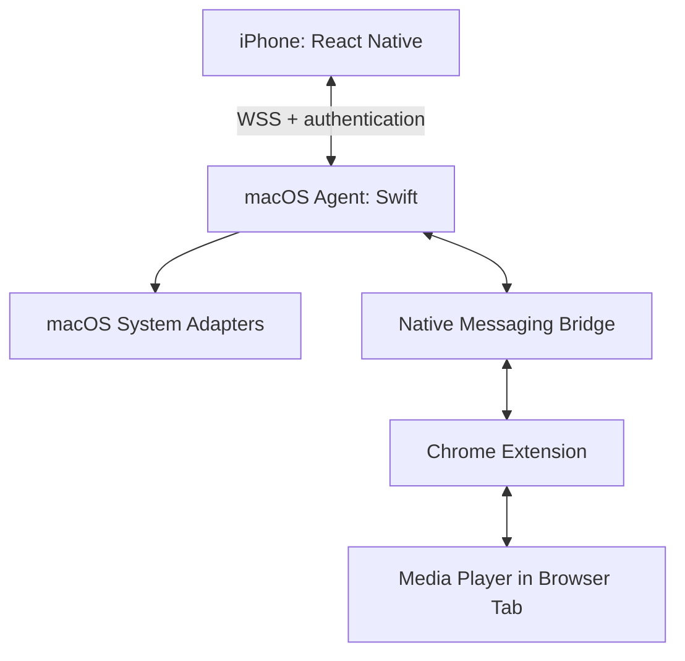

# Remote Control

An iPhone remote for controlling a MacBook over a local network.

The product provides convenient access to audio, video playback, and selected system actions from a phone. The engineering goals are maintainable code, a secure command protocol, and predictable behavior when connectivity is interrupted.

**Status: local foundation configured.** The iOS-focused mobile starter, formatting, ESLint, TypeScript checks, and Git hooks have been configured. The combined local check passes, and the pre-commit hook ran successfully during the initial commit. Two upstream ESLint peer-dependency warnings remain documented in an ADR. Native iPhone execution, Mac control, pairing, the browser extension, and CI have not been implemented or verified yet. The architecture below describes the planned product.

## Contents

- [Features and Status](#features-and-status)
- [Design and Interaction](#design-and-interaction)
- [Architecture](#architecture)
- [Repository Structure](#repository-structure)
- [Development Environment](#development-environment)
- [Getting Started](#getting-started)
- [Code Quality](#code-quality)
- [Security Model](#security-model)
- [State and Connection Recovery](#state-and-connection-recovery)
- [Platform Limitations](#platform-limitations)
- [Documentation](#documentation)
- [Implementation Roadmap](#implementation-roadmap)
- [Demo and Screenshots](#demo-and-screenshots)
- [References](#references)

## Features and Status

| Feature                | Scope                                                     | Status                                               |
| ---------------------- | --------------------------------------------------------- | ---------------------------------------------------- |
| Mobile client          | React Native, TypeScript, Expo Router                     | Scaffolded; local typecheck passes                   |
| Pairing                | Add an iPhone using a QR code and confirmation on the Mac | Planned for MVP                                      |
| Audio control          | Volume, mute, and current state                           | Planned for MVP                                      |
| YouTube                | Play/pause, seeking, and tab selection                    | Planned for MVP                                      |
| Timer                  | Pause the selected video after a specified duration       | Planned for MVP                                      |
| Video websites         | Playback controls and next episode                        | After MVP; a separate site adapter is required       |
| Mac sleep and shutdown | Standard system actions                                   | After API and permission validation                  |
| Brightness             | Hardware display brightness                               | Experimental; requires testing on the target MacBook |
| Touchpad               | Pointer movement, clicking, and scrolling                 | Later milestone                                      |
| Quality tooling        | ESLint, Prettier, Husky, and lint-staged                  | Configured locally; pre-commit verified              |
| CI                     | Automated repository-side checks                          | Planned                                              |

The first target configuration is a physical iPhone, an Apple Silicon MacBook, and Chrome. Support for additional devices and browsers will follow validation of the primary workflow.

The mobile configuration explicitly targets iOS. Web-specific tab, animation, and color-scheme starter implementations have been removed. Remaining demo screens, images, stylesheets, and the reset script are retained until the starter UI is replaced. The Chrome extension is a separate application and remains part of the product architecture.

## Design and Interaction

Visual quality is a product requirement.

The initial direction is a dark graphite theme, a single accent color, clear typography, large controls, and comfortable one-handed use. Final colors and components will be defined during interface design.

The main screens are planned as follows:

- Mac discovery and pairing.
- A remote with current media, volume, and timer controls.
- A touchpad at the corresponding implementation milestone.
- Settings, device access, and diagnostics.

Required UI states include discovery, connection, denied permissions, a missing media target, connection loss, and synchronization after reconnecting. Action feedback must reflect the result on the Mac.

Animations and haptics should support user actions. Contrast, text scaling, accessible control labels, and adequate touch targets will be checked during UI development.

## Architecture

The product has three planned application components:

1. **Mobile client:** the user interface, connection management, and presentation of confirmed state.
2. **macOS Agent:** a local command server, system API integration, timer execution, and permission enforcement.
3. **Chrome Extension:** media-player selection within a tab and execution of media commands.



The first version does not require a separate cloud backend. The macOS Agent provides the server role on the computer being controlled. Commands should travel over the local network without depending on an internet service. Video websites may still require internet access.

The Agent runs in the current macOS user session. Docker is not part of the baseline architecture: a Linux container does not provide the macOS environment required by SwiftUI, Accessibility, and the relevant system APIs.

### Agent Layers

| Layer          | Responsibility                         | Examples                                                |
| -------------- | -------------------------------------- | ------------------------------------------------------- |
| Domain         | Command and state rules                | Valid values, permissions, and retry policies           |
| Application    | Use-case execution                     | Set volume or create a timer                            |
| Infrastructure | Integration with external systems      | CoreAudio, Keychain, networking, and the browser bridge |
| Presentation   | Menu, settings, and state explanations | SwiftUI                                                 |

These names describe the intended organization. Concrete files and interfaces will be introduced alongside their implementation.

## Repository Structure

| Path                                  | Responsibility                                   | Status                          |
| ------------------------------------- | ------------------------------------------------ | ------------------------------- |
| `apps/mobile/`                        | React Native mobile application                  | Created                         |
| `apps/mobile/src/app/`                | Expo Router file-based routes and layouts        | Included in the starter         |
| `apps/mobile/src/components/`         | UI components                                    | Included in the starter         |
| `apps/mobile/src/constants/`          | Existing starter constants and theme             | Included in the starter         |
| `apps/mobile/modules/remote-network/` | Swift Expo Module for networking                 | Planned                         |
| `apps/macos/`                         | Agent, SwiftUI interface, and system adapters    | Planned                         |
| `apps/browser-extension/`             | Chrome extension and media adapters              | Planned                         |
| `packages/protocol/`                  | Command schemas, TypeScript models, and fixtures | Planned                         |
| `packages/remote-core/`               | Shared Swift package                             | Planned                         |
| `docs/`                               | Technical explanations and guides                | Added incrementally             |
| `package.json`                        | Root commands and tooling configuration          | Configured                      |
| `pnpm-workspace.yaml`                 | pnpm workspace boundaries                        | Configured                      |
| `pnpm-lock.yaml`                      | Resolved dependency tree                         | Created                         |
| `.nvmrc`                              | Selected Node.js version                         | Configured                      |
| `.husky/`                             | Pre-commit and pre-push commands                 | Configured; pre-commit verified |
| `apps/mobile/eslint.config.cjs`       | Expo lint rules and compatibility adapter        | Configured                      |
| `.prettierrc.json`                    | Shared formatting policy                         | Configured                      |
| `.github/workflows/`                  | Automated checks                                 | Planned                         |

The pnpm workspace manages JavaScript and TypeScript packages with their own `package.json` files. Swift projects can live in the same Git repository, while Swift Package Manager and Xcode manage their dependencies and builds.

YAML is a structured data format. pnpm reads `pnpm-workspace.yaml` to determine which directories belong to the workspace. Other YAML files may configure CI or Docker Compose; their purpose depends on the consuming tool and schema.

## Development Environment

The initial development environment is:

| Tool    | Version           |
| ------- | ----------------- |
| Node.js | 24.22.3           |
| pnpm    | 11.28.11          |
| Xcode   | 27.2, build 27B52 |
| Swift   | 6.4.2, arm64      |
| Git     | 2.41.0            |

The mobile starter was requested using `--template default@sdk-58`. Refer to `apps/mobile/package.json` and the lockfile for the actual application dependencies.

Contributors should use the selected Node.js and pnpm versions and install dependencies from the lockfile. Apple application targets require macOS and a compatible Xcode installation.

## Getting Started

Run the following commands from the repository root to select Node.js:

```bash
nvm install
nvm use
```

These commands apply when Node.js is managed through nvm. The root `package.json` specifies the pnpm version in its `packageManager` field. If pnpm is not installed yet, install the pinned version:

```bash
npm install --global pnpm@11.28.11
```

Install dependencies:

```bash
pnpm install --frozen-lockfile
```

For the first Expo startup:

```bash
pnpm --dir apps/mobile exec expo start --offline
```

Expo generates environment types during startup. Once Metro is ready, stop it with Ctrl+C and run the TypeScript check:

```bash
pnpm typecheck
```

The `--offline` flag disables external network checks in the Expo CLI. It does not produce a standalone release build.

For subsequent Metro development sessions:

```bash
pnpm dev:mobile
```

Physical iPhone installation, signing, and the development build are still being configured. Commands for running the macOS Agent and browser extension will be added when those components exist.

### Initial Setup Notes

The initial TypeScript check reported missing CSS declarations and an incompatible `ref` type in starter web components. A subsequent local check completed without errors.

The latest combined local check passes: formatting, ESLint, and TypeScript. Native compilation and execution on a physical iPhone have not yet been confirmed.

A future clean checkout must also generate the required Expo types before type checking. The corresponding bootstrap step will be included in CI.

## Code Quality

The baseline local checks are configured. CI, automated tests, and native build checks will be added alongside their implementation.

| Mechanism                    | Responsibility                                                 | Current Status                                 |
| ---------------------------- | -------------------------------------------------------------- | ---------------------------------------------- |
| TypeScript strict mode       | Application type consistency                                   | Passing locally                                |
| ESLint flat config           | JavaScript/TypeScript, React, and hooks rules                  | Passing locally with the compatibility adapter |
| Prettier                     | Consistent TS/JS/JSON/YAML/Markdown formatting                 | Passing locally                                |
| Husky pre-commit             | Run lint-staged during a commit                                | Verified during the initial commit             |
| lint-staged                  | Lint and format staged files using their nearest configuration | Verified during the initial commit             |
| Husky pre-push               | Run the full local check before a push                         | Configured; hook invocation not yet verified   |
| Unit and contract tests      | Business rules and command contracts                           | Planned                                        |
| Swift formatting and linting | Swift code consistency                                         | Planned when Swift targets exist               |
| Native build checks          | Compilation of actual Apple targets                            | Planned                                        |
| Required status checks       | Successful CI checks before merging                            | Planned                                        |

### Local Commands

Run these commands from the repository root:

| Command             | Behavior                                          |
| ------------------- | ------------------------------------------------- |
| `pnpm lint`         | Check mobile code; fail on warnings or errors     |
| `pnpm lint:fix`     | Apply available ESLint fixes                      |
| `pnpm typecheck`    | Check mobile TypeScript without emitting files    |
| `pnpm format`       | Apply formatting to supported repository files    |
| `pnpm format:check` | Check formatting without rewriting files          |
| `pnpm check`        | Run format:check, lint, and typecheck in sequence |

The lint and typecheck commands currently cover the mobile package. Extend their scope when shared TypeScript packages and the browser extension are added.

ESLint and Prettier have separate responsibilities. The Prettier compatibility preset disables conflicting lint formatting rules. The mobile lint configuration rejects explicit `any` and enforces type-only imports. Additional type-aware rules can be introduced with the relevant tsconfig and performance considerations.

### ESLint Compatibility

The current environment uses ESLint 10.14.0 with `@eslint/compat` 2.1.1.

The Expo preset includes `eslint-plugin-react` 7.37.5 and `eslint-plugin-import` 2.32.0. Their declared peer ranges stop at ESLint 9. The configuration wraps the Expo preset with `fixupConfigRules` to adapt the plugin APIs.

The current source passes linting, but this does not establish compatibility for every plugin rule. The two peer-dependency warnings remain visible. No peer-range suppression or override is configured.

See [ADR 0001: ESLint Plugin Compatibility](docs/adr/0001-eslint-compatibility.md) for the temporary decision, validation limits, and removal conditions.

### Git Hooks

The root owns Husky and lint-staged. The root lint-staged configuration formats supported staged files. The mobile configuration runs ESLint and Prettier for mobile source files and formats its supported configuration and documentation files.

lint-staged selects the configuration nearest to each file; it does not merge the root configuration into the mobile one. Files rewritten by the tasks are staged automatically.

The pre-commit hook completed successfully during the initial commit. During a first commit, lint-staged cannot create a backup stash against an existing commit; subsequent commits have a previous commit available.

The pre-push hook runs `pnpm check`. Its configuration is present, but hook invocation has not yet been verified. Local hooks can be bypassed; repository-side CI and required status checks remain a separate planned step.

### Testing Plan

Tests should cover behavior where failures matter: authentication, access revocation, timers, reconnection, stale commands, and site adapters. Coverage targets should reflect meaningful scenarios; a single percentage does not establish product correctness.

### Development Workflow

1. Give each change a concrete purpose and clear scope.
2. Run local checks before committing.
3. Update documentation when behavior or setup changes.
4. Review the staged changes; pre-commit may apply formatting or lint fixes.
5. Describe the result and validation in the pull request.
6. Once CI is configured, require it to pass before merging.
7. Record physical-device checks separately from automated checks.

## Security Model

Planned properties include:

- QR pairing with a short-lived, single-use secret and confirmation on the Mac.
- TLS with Mac identity verification before secrets are transmitted.
- A separate token for each trusted phone.
- Keychain storage for secrets, access revocation, and active-session termination.
- An explicit command allowlist with argument and permission validation.
- Separate media, audio, input, and power permissions as needed.
- Message-size and command-rate limits.
- Narrow browser-extension permissions.
- Separation between media integration and system input/power commands.
- No arbitrary shell commands or scripts in the network protocol.
- Logs that exclude tokens, pairing secrets, and entered text.

Bonjour provides discovery, not proof of trust. Sharing the same Wi-Fi network does not automatically grant access.

The iPhone and Mac must have a reachable network path. Guest-network isolation and firewalls can block communication.

These mechanisms must be implemented and validated before remote control is enabled.

## State and Connection Recovery

The Mac is the source of system state, while the extension supplies the state of the selected media player. The phone displays a received snapshot and subsequent updates.

After a connection is interrupted:

1. The client displays the connection loss.
2. Stale input events are discarded.
3. Bounded reconnection attempts are made.
4. The session authenticates again.
5. A current state snapshot is loaded.

Next-episode actions, clicks, and shutdown commands are not retried automatically. Commands require request identifiers, timeouts, and explicit idempotency rules.

The timer runs on the Mac and does not depend on the iPhone screen remaining open. Agent restart and Mac wake policies will be documented alongside the timer implementation.

## Platform Limitations

- Volume control depends on the capabilities of the current audio output.
- Hardware brightness control requires testing on the specific display.
- Touchpad input requires Accessibility permission and physical-device latency testing.
- Next-episode behavior depends on the structure of the video website.
- Cross-origin players require the relevant browser host permissions.
- Browser policies may restrict play and fullscreen requests.
- iOS may suspend the application in the background; returning to the foreground requires synchronization.
- Unsaved-file dialogs may delay or cancel a normal Mac shutdown.
- A native development build requires initial signing configuration.
- TestFlight builds have a limited availability period; distribution will be configured separately.

## Documentation

Documentation is updated in the same change that modifies functionality, architecture, or setup.

README is the entry point: purpose, current status, getting started, the main architecture diagram, repository structure, checks, and links to detailed documentation.

Existing documentation:

- [Development Setup](docs/development-setup.md): the initial iOS and tooling setup guide. Read ADR 0001 for the subsequent ESLint compatibility addition.
- [ADR 0001](docs/adr/0001-eslint-compatibility.md): the temporary ESLint plugin compatibility decision.

Planned documents:

| Document                           | Contents                                                 |
| ---------------------------------- | -------------------------------------------------------- |
| `docs/architecture.md`             | Components, layers, data flows, and ownership boundaries |
| `docs/protocol.md`                 | Commands, responses, errors, versions, and compatibility |
| `docs/security.md`                 | Threat model, pairing, secret storage, and permissions   |
| `docs/development.md`              | Environment, startup, debugging, and troubleshooting     |
| `docs/testing.md`                  | Test strategy and physical-device matrix                 |
| `docs/adr/`                        | Decisions, alternatives, rationale, and consequences     |
| `docs/Remote_Control_Explained.md` | Learning notes and interview questions                   |

This table is a documentation plan; it does not imply that all listed files already exist.

Each module should document its responsibility and relationships. Complex public functions and contracts should also be documented near the code: arguments, results, errors, and important constraints. README should not manually duplicate the implementation of every internal function.

Planned diagrams cover components, pairing, the command path, connection recovery, and timer lifecycle. Each diagram is added once the corresponding behavior is defined.

### Project Language

All project text is written in English, including documentation, code comments, docstrings, UI text, error messages, logs, test descriptions, commit messages, and pull request descriptions. Identifiers and file names should also use clear English names.

Comments should explain intent, constraints, or non-obvious decisions rather than restating the code.

## Implementation Roadmap

1. Baseline local quality tooling and the initial commit are complete; verify pre-push and add CI next.
2. Replace the demo UI and then remove unused starter images, styles, and scripts.
3. Configure the development build and launch it on a physical iPhone.
4. Create the macOS Agent and validate system APIs.
5. Implement pairing, a secure command, and confirmed volume state.
6. Add the Chrome extension and YouTube integration.
7. Add the timer, reconnection, and device-access revocation.
8. Extend site integrations, power actions, and validated brightness control.
9. Implement and measure the touchpad.
10. Prepare a stable demo, installation guide, and distribution workflow.

## Demo and Screenshots

Demo footage and screenshots will be added after the screens and first working scenario are implemented. They should show the actual interface and behavior of the corresponding version.

The planned demonstration covers connecting to a Mac, changing volume, controlling a selected tab, using the timer, and recovering from a connection loss.

## References

- [Expo: monorepos](https://docs.expo.dev/guides/monorepos/)
- [Expo: TypeScript](https://docs.expo.dev/guides/typescript/)
- [Expo: generated types](https://docs.expo.dev/router/reference/typed-routes/)
- [Expo: ESLint and Prettier](https://docs.expo.dev/guides/using-eslint/)
- [Expo: platform-specific modules](https://docs.expo.dev/router/advanced/platform-specific-modules/)
- [pnpm: workspaces](https://pnpm.io/workspaces)
- [Husky: getting started](https://typicode.github.io/husky/get-started.html)
- [lint-staged: documentation](https://github.com/lint-staged/lint-staged)
- [GitHub: required status checks](https://docs.github.com/en/repositories/configuring-branches-and-merges-in-your-repository/managing-protected-branches/about-protected-branches)
- [Apple: local network privacy](https://developer.apple.com/documentation/technotes/tn3179-understanding-local-network-privacy)
- [Chrome: Native Messaging](https://developer.chrome.com/docs/extensions/develop/concepts/native-messaging)
