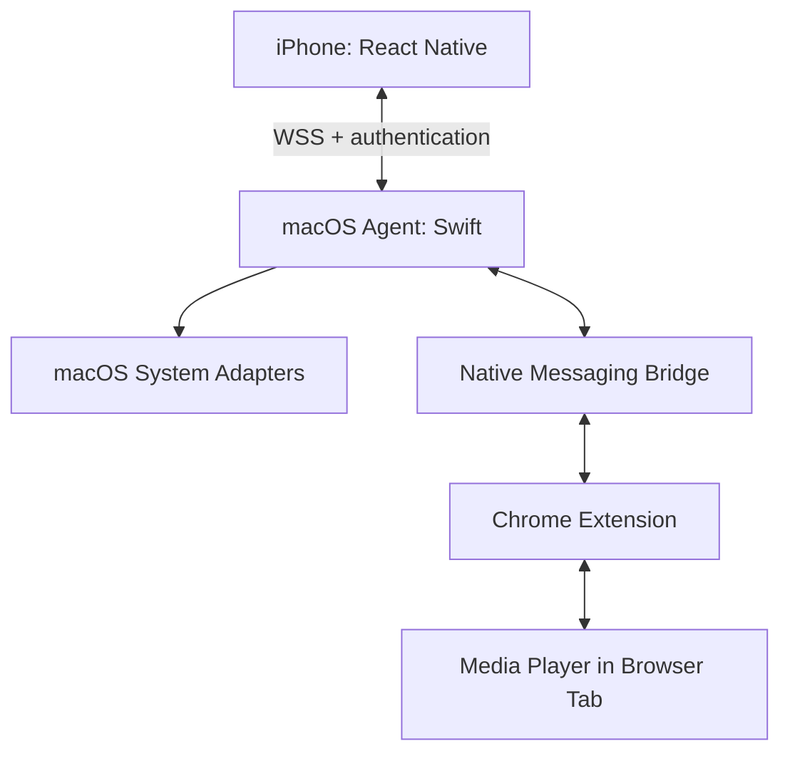

# Remote Control

An iPhone remote for controlling a MacBook over a local network.

The product provides convenient access to audio, video playback, and selected system actions from a phone. The engineering goals are maintainable code, a secure command protocol, and predictable behavior when connectivity is interrupted.

**Status: audio and selected YouTube playback verified on the primary devices; YouTube CI passed before merge.** On November 23, 2026, the maintainer verified phone Pause/Play, browser-to-phone state synchronization, changing videos in the selected watch tab, and continued audio control after closing that tab. The Mac Agent/helper build and physical iOS build completed. The iOS build required a macOS/Linux compilation guard for the browser runtime store; playback required UUID normalization across Swift and Chrome. The YouTube baseline passed 28 mobile and 14 extension tests; the timer increment passes 34 and 16 respectively. Final native checks and both CI jobs subsequently passed before merge; broader device/failure coverage remains pending. See [Selected YouTube control](docs/youtube-control.md) for the exact recorded matrix.

## Contents

- [Features and Status](#features-and-status)
- [Design and Interaction](#design-and-interaction)
- [Architecture](#architecture)
- [Repository Structure](#repository-structure)
- [Development Environment](#development-environment)
- [Getting Started](#getting-started)
- [Code Quality](#code-quality)
- [Security Model](#security-model)
- [State and Connection Recovery](#state-and-connection-recovery)
- [Platform Limitations](#platform-limitations)
- [Documentation](#documentation)
- [Implementation Roadmap](#implementation-roadmap)
- [Demo and Screenshots](#demo-and-screenshots)
- [References](#references)

**Current milestone: a Mac-owned sleep timer.** The connected remote can request a 1–720-minute countdown that pauses the current video in the explicitly selected YouTube document. The countdown continues without an open phone session. Portable implementation checks pass; updated Apple builds, physical-device acceptance and timer CI are pending. See [Sleep timer](docs/sleep-timer.md). Seeking, other sites and Mac power actions remain future work.

## Features and Status

| Feature                | Scope                                                                      | Status                                                                                |
| ---------------------- | -------------------------------------------------------------------------- | ------------------------------------------------------------------------------------- |
| Mobile client          | React Native, TypeScript, Expo Router                                      | Compiled, signed, installed, and opened on iPhone XR                                  |
| macOS Agent shell      | SwiftUI menu-bar panel, setup status, and Quit action                      | Shell baseline CI passed; local audio build and primary controls verified             |
| iOS development build  | Local Xcode compilation, signing, installation, and Metro connection       | Manually verified on iPhone XR, iOS 18.7.12                                           |
| Interactive preview    | Volume, mute, playback state, seeking, and timer preset selection          | Implemented with local sample state only                                              |
| Pairing                | Add an iPhone using a QR code and confirmation on the Mac                  | Pairing baseline CI passed; live audio revocation/re-pairing verified locally         |
| Audio control          | Volume and mute on the current Mac output                                  | Primary-device checks, final 23 mobile tests and both feature CI jobs passed          |
| YouTube                | Selected Chrome watch-tab metadata and absolute play/pause                 | Primary-device workflow and both feature CI jobs passed before merge                  |
| Timer                  | Pause the selected video after a custom duration                           | Implemented with custom minute precision; native/device checks and feature CI pending |
| Localization           | System language, English, and Ukrainian; typed bundled resources           | Implemented; prior detailed checks in Expo Go and native smoke check                  |
| Appearance             | System, light, and dark themes                                             | Implemented; prior detailed checks in Expo Go and native smoke check                  |
| Preferences            | Persistent language and appearance choices                                 | Persistence checked in Expo Go; native smoke check completed                          |
| Video websites         | Playback controls and next episode                                         | After MVP; a separate site adapter is required                                        |
| Mac sleep and shutdown | Standard system actions                                                    | After API and permission validation                                                   |
| Brightness             | Hardware display brightness                                                | Experimental; requires testing on the target MacBook                                  |
| Touchpad               | Pointer movement, clicking, and scrolling                                  | Later milestone                                                                       |
| Quality tooling        | ESLint, Prettier, Husky, and lint-staged                                   | Configured; pre-commit and pre-push verified                                          |
| CI                     | Automated formatting, lint, type checks, and unit tests                    | Existing workflow verified; unit tests added to `pnpm check`                          |
| Branch protection      | Pull requests, required CI, deletion protection, and force-push protection | Active for `main`                                                                     |

The first target configuration is a physical iPhone, an Apple Silicon MacBook, and Chrome. Support for additional devices and browsers will follow validation of the primary workflow.

The mobile configuration explicitly targets iPhone and allows system, light, and dark appearance. Expo demo routes, starter UI components, CSS, and unused images have been removed. Existing app-icon and splash assets remain placeholders until the branding milestone. The legacy reset script remains outside the new UI and will be reviewed separately. Browser packages remain in the dependency manifest for a separate lockfile-aware cleanup; there is no mobile web target or web UI. The Chrome extension is a separate application and remains part of the product architecture.

## Design and Interaction

Visual quality is a product requirement.

The mobile shell uses graphite surfaces and a soft lime accent in dark mode, with a separate light palette using darker green accents. Both modes share system typography, SF Symbols, rounded controls, and generous spacing. The Mac illustration is built from native views rather than a downloaded image. The interface scrolls on smaller screens and keeps text scaling enabled. The preview layout has been reviewed on an iPhone. Further device checks will cover larger text sizes, contrast, VoiceOver behavior, and one-handed use.

The current mobile app contains home, connection guide, pairing, Mac remote (audio, selected YouTube and sleep timer), interactive preview, and Settings screens. Planned connected-product screens include:

- Automatic Mac discovery.
- Additional connected controls beyond current media, volume and the timer.
- A touchpad at the corresponding implementation milestone.
- Settings, device access, and diagnostics.

Required UI states include discovery, connection, denied permissions, a missing media target, connection loss, and synchronization after reconnecting. Action feedback must reflect the result on the Mac.

Animations and haptics should support user actions. Contrast, text scaling, accessible control labels, and adequate touch targets will be checked during UI development.

## Architecture

The product architecture separates three application components. The mobile app and macOS Agent run on their target devices. Pairing and remote audio are verified on the primary devices. Selected YouTube integration has passed its primary native/browser/device workflow:

1. **Mobile client:** the user interface, connection management, and presentation of confirmed state.
2. **macOS Agent:** a local command server, system API integration, timer execution, and permission enforcement.
3. **Chrome Extension:** media-player selection within a tab and execution of media commands.



The first version does not require a separate cloud backend. The macOS Agent provides the server role on the computer being controlled. Commands should travel over the local network without depending on an internet service. Video websites may still require internet access.

The Agent runs in the current macOS user session. Docker is not part of the baseline architecture: a Linux container does not provide the macOS environment required by SwiftUI, Accessibility, and the relevant system APIs.

### Agent Layers

| Layer          | Responsibility                         | Examples                                                |
| -------------- | -------------------------------------- | ------------------------------------------------------- |
| Domain         | Command and state rules                | Valid values, permissions, and retry policies           |
| Application    | Use-case execution                     | Set volume or create a timer                            |
| Infrastructure | Integration with external systems      | CoreAudio, Keychain, networking, and the browser bridge |
| Presentation   | Menu, settings, and state explanations | SwiftUI                                                 |

These names describe the intended organization. Concrete audio, pairing, browser and transport files are mapped in the linked feature guides.

## Repository Structure

| Path                                       | Responsibility                                                             | Status                                                                           |
| ------------------------------------------ | -------------------------------------------------------------------------- | -------------------------------------------------------------------------------- |
| `apps/mobile/`                             | React Native mobile application                                            | Native development build running on iPhone XR                                    |
| `apps/mobile/ios/`                         | Generated Xcode project and CocoaPods integration                          | Generated locally; ignored by Git                                                |
| `apps/mobile/src/app/`                     | Root navigator and thin route entry points                                 | Implemented                                                                      |
| `apps/mobile/src/components/`              | Shared UI primitives                                                       | Implemented                                                                      |
| `apps/mobile/src/design-system/`           | Light/dark palettes, design tokens, and theme-aware style hooks            | Implemented                                                                      |
| `apps/mobile/src/localization/`            | Typed English/Ukrainian resources and a language-bound translation hook    | Implemented                                                                      |
| `apps/mobile/src/preferences/`             | Preference types, restoration, context, and serialized storage writes      | Implemented                                                                      |
| `apps/mobile/src/features/settings/`       | Language and appearance controls                                           | Implemented                                                                      |
| `apps/mobile/src/package.json`             | ESM scope for source modules used by Node-based tests                      | Configured                                                                       |
| `apps/mobile/tests/`                       | Preferences, localization, contrast, and native-summary tests              | 34 mobile tests passed for the timer increment                                   |
| `apps/mobile/src/features/pairing/`        | QR scan, approval comparison, and saved-access UI                          | Verified locally                                                                 |
| `apps/mobile/src/features/connection/`     | Disconnected home, Mac illustration, and connection guide                  | Implemented; discovery planned                                                   |
| `apps/mobile/src/features/remote-audio/`   | Authenticated audio screen, validated summaries, and foreground session    | Audio verified; includes the new media-aware session                             |
| `apps/mobile/src/features/remote-preview/` | Preview screen, cards, timer picker, and isolated UI state                 | Implemented; local preview only                                                  |
| `packages/remote-link/`                    | Shared Swift pairing protocol, native iOS transport, and typed Expo facade | Pairing baseline CI passed; live audio revocation/re-pairing verified locally    |
| `apps/macos/`                              | SwiftUI Agent shell and native project configuration                       | Built and manually checked locally                                               |
| `apps/macos/project.yml`                   | Declarative macOS application target and scheme                            | Project generation and native build passed locally                               |
| `apps/macos/Sources/`                      | Menu-bar scene, audio adapter, pairing server, and panel UI                | Implemented and checked locally                                                  |
| `apps/mobile/src/features/youtube/`        | Confirmed selected-media card and fixed playback failures                  | Primary-device title, state and playback verified                                |
| `apps/macos/BrowserHost/`                  | Separate Native Messaging executable                                       | Built and registered on the maintainer’s Mac                                     |
| `packages/remote-link/src/media.ts`        | Pure media contract shared by Chrome and mobile                            | Shared fixture tests pass                                                        |
| `apps/browser-extension/`                  | MV3 popup, worker, selected document adapter and tests                     | Primary Chrome/iPhone playback workflow verified; feature CI passed before merge |
| `packages/remote-core/`                    | Shared Swift audio service and timer deadline/ownership state machine      | 25 portable tests passed; timer Apple checks pending                             |
| `docs/`                                    | Technical explanations and guides                                          | Added incrementally                                                              |
| `package.json`                             | Root commands and tooling configuration                                    | Configured                                                                       |
| `pnpm-workspace.yaml`                      | pnpm workspace boundaries                                                  | Configured                                                                       |
| `pnpm-lock.yaml`                           | Resolved dependency tree                                                   | Created                                                                          |
| `.nvmrc`                                   | Selected Node.js version                                                   | Configured                                                                       |
| `.husky/`                                  | Pre-commit and pre-push commands                                           | Both hooks verified                                                              |
| `apps/mobile/eslint.config.cjs`            | Expo lint rules and compatibility adapter                                  | Configured                                                                       |
| `.prettierrc.json`                         | Shared formatting policy                                                   | Configured                                                                       |
| `.github/workflows/ci.yml`                 | GitHub Actions formatting, lint, and type checks                           | Implemented and verified                                                         |

The pnpm workspace manages JavaScript and TypeScript packages with their own `package.json` files. Swift projects can live in the same Git repository, while Swift Package Manager and Xcode manage their dependencies and builds.

YAML is a structured data format. pnpm reads `pnpm-workspace.yaml` to determine which directories belong to the workspace. Other YAML files may configure CI or Docker Compose; their purpose depends on the consuming tool and schema.

### Timer Source Map

| Path                                                              | Responsibility                                                           |
| ----------------------------------------------------------------- | ------------------------------------------------------------------------ |
| `apps/mobile/src/features/sleep-timer/`                           | Confirmed timer card and local minute-precision duration editor          |
| `apps/macos/Sources/RemoteControlAgent/Timer/`                    | Mac-owned scheduling, expiry playback and status/cancel UI               |
| `packages/remote-core/Sources/RemoteCore/SleepTimerMachine.swift` | Pure deadline and ownership rules                                        |
| `packages/remote-link/src/timer.ts`                               | Shared framework-free timer DTO validation                               |
| `docs/sleep-timer.md`                                             | Behavior, state diagram, security, setup, file map and acceptance matrix |

## Development Environment

The locally verified development environment is:

| Tool      | Version           |
| --------- | ----------------- |
| Node.js   | 24.22.3           |
| pnpm      | 11.28.11          |
| Xcode     | 27.2, build 27B52 |
| Swift     | 6.4.2, arm64      |
| Git       | 2.41.0            |
| CocoaPods | 1.17.0            |
| XcodeGen  | 2.46.0            |

The mobile starter was requested using `--template default@sdk-58`. Refer to `apps/mobile/package.json` and the lockfile for the actual application dependencies.

Contributors should use the selected Node.js and pnpm versions and install dependencies from the lockfile. Apple application targets require macOS and a compatible Xcode installation.

## Getting Started

Run the following commands from the repository root to select Node.js:

```bash
nvm install
nvm use
```

These commands apply when Node.js is managed through nvm. The root `package.json` specifies the pnpm version in its `packageManager` field. If pnpm is not installed yet, install the pinned version:

```bash
npm install --global pnpm@11.28.11
```

Install dependencies:

```bash
pnpm install --frozen-lockfile
```

Generate the local Expo type declarations and run the quality checks:

```bash
pnpm --dir apps/mobile exec expo customize tsconfig.json
pnpm check
```

### First Physical-Device Build

With Xcode, CocoaPods, pairing, Developer Mode, and an Apple Development signing identity configured:

```bash
pnpm --dir apps/mobile exec expo run:ios --device
```

Select the physical iPhone and the intended development team if prompted. Expo generates the ignored iOS project when absent, compiles and signs the app, installs it, and attempts to launch it. A free Personal Team can be used for local testing; its provisioning profiles require renewal after seven days.

See [iOS Development Build](docs/ios-development-build.md) for the complete device, signing, trust, and troubleshooting steps. A simulator runtime is not required for this physical-device workflow.

### Daily Development

After the native build is installed:

```bash
pnpm --dir apps/mobile exec expo start --dev-client
```

Scan the terminal QR code using the iPhone camera and open it in Remote Control. Keep the Mac and iPhone on a reachable local network and allow local-network access if requested. The installed app loads its development JavaScript from Metro. Ordinary UI, style, and translation edits do not require another native compilation.

Rebuild after native dependency or configuration changes, regenerating the native project from configuration as described in the build guide. Durable native settings belong in `app.json` and config plugins; `apps/mobile/ios/` is generated and ignored.

### Validation Status

The home, preview, and preferences were first checked in Expo Go. Explicit language/theme persistence and system appearance changes were manually verified there. On November 16, 2026, the custom development build launched on iPhone XR with Metro, and the maintainer reported its existing functionality working. A separate exhaustive native regression matrix has not been recorded.

The prior audio milestone passed final `pnpm check` with 23 mobile tests and both CI jobs. This change expands the automated checks to 28 mobile and 14 extension tests. Run the checks again before committing changes. The existing CI job generates Expo types before running those checks; it does not compile iOS. TestFlight, standalone release behavior, broader device coverage, and accessibility checks remain separate work.

### macOS Agent Shell

With XcodeGen installed, check and open the native Mac shell:

```bash
make -C apps/macos check
make -C apps/macos run DEVELOPMENT_TEAM=YOUR_TEAM_ID
```

Pairing uses the developer-signed `SignedDebug` configuration. Supply your own team ID or create the ignored local signing configuration described in [the Mac guide](apps/macos/README.md). The default quality-check/CI `Debug` build stays ad hoc. The signed launch target verifies the built signature and application/team identifier entitlements before opening the app.

The menu-bar Agent now includes local audio controls alongside phone-connection status and a Quit action. The expanded native check and the primary volume/mute controls passed on the maintainer's built-in speakers on November 19, 2026. Output switching, unsupported devices, and accessibility remain unverified. QR pairing, saved-access verification, persistence across app restarts, revocation, and re-pairing passed the physical-device workflow on November 20, 2026. The authenticated audio session passed primary device checks and both feature CI jobs. The YouTube primary workflow passed; final native checks and both feature CI jobs passed before merge as `e92bec1`. The maintainer passed `make -C apps/macos check` and verified launch, Quit and relaunch, light/dark appearance, and both bundled languages on November 18, 2026. The shell baseline passed the native CI job; the pairing baseline passed both CI jobs; the audio integration also passed both CI jobs. See [the macOS package guide](apps/macos/README.md) and [macOS Agent Shell](docs/macos-agent-shell.md) for the file map and validation checklist.

### YouTube Development Setup

`pnpm check` builds `apps/browser-extension/dist`. Register its local helper with `make -C apps/macos install-browser-host`, then load that directory as an unpacked extension in Chrome. Rebuild the iOS app for the updated native playback function. In the Agent, Start connections and Enable YouTube; in Chrome, reload a watch page and select it from the extension popup.

See [YouTube setup](docs/youtube-control.md#installation-for-local-development) for the exact installation sequence, expected extension ID, recovery, and uninstall steps.

## Code Quality

Local quality checks and GitHub Actions are configured. `pnpm check` covers formatting, three ESLint scopes, mobile/extension TypeScript, 34 mobile tests, 16 extension tests and the unpacked extension build. The macOS workflow also compiles the Agent and Native Messaging helper. Primary YouTube device checks passed; final native checks and both feature CI jobs passed before merge as `e92bec1`; broader coverage remains pending.

| Mechanism                    | Responsibility                                                                 | Current Status                                                                         |
| ---------------------------- | ------------------------------------------------------------------------------ | -------------------------------------------------------------------------------------- |
| TypeScript strict mode       | Application type consistency                                                   | Passing in the implementation workspace; baseline CI verified                          |
| ESLint flat config           | JavaScript/TypeScript, React, and hooks rules                                  | Passing in the implementation workspace; baseline CI verified                          |
| Prettier                     | Consistent TS/JS/JSON/YAML/Markdown formatting                                 | Passing in the implementation workspace; baseline CI verified                          |
| Husky pre-commit             | Run lint-staged during a commit                                                | Verified during the initial commit                                                     |
| lint-staged                  | Lint and format staged files using their nearest configuration                 | Verified during the initial commit                                                     |
| Husky pre-push               | Run the full local check before a push                                         | Verified during pushes and with a restricted PATH                                      |
| GitHub Actions               | Run quality checks on pushes and pull requests targeting `main`                | Implemented and verified                                                               |
| Unit tests                   | Preference recovery, persistence, localization, contrast, and native summaries | 28 mobile and 14 extension tests pass; included in `pnpm check`                        |
| Swift core tests             | Audio command safety and observer lifecycle                                    | 17 passed on the Mac and Swift 6.0.3/Linux                                             |
| Swift pairing tests          | Invitation/frame validation, single use, deadlines, and Apple crypto           | 31 portable protocol tests pass on Linux; prior 28-test Apple suite passed on Mac      |
| Contract tests               | Shared Swift/TypeScript audio fixture; connected device scenarios              | Fixture tests and primary manual audio scenarios passed; broader cases pending         |
| Swift formatting and linting | Native Swift source style                                                      | Passed strict lint in the implementation workspace and on the Mac                      |
| Native build checks          | Compilation, installation, and launch                                          | iOS launch, Mac Debug/SignedDebug builds, and physical-device pairing verified locally |
| Required status checks       | Successful CI checks before merging                                            | Active for `main`; `Quality checks` is required                                        |

### Local Commands

Run these commands from the repository root:

| Command             | Behavior                                                              |
| ------------------- | --------------------------------------------------------------------- |
| `pnpm lint`         | Check mobile, native facade and extension; fail on warnings or errors |
| `pnpm lint:fix`     | Apply available ESLint fixes                                          |
| `pnpm typecheck`    | Check mobile and extension TypeScript without emitting files          |
| `pnpm format`       | Apply formatting to supported repository files                        |
| `pnpm format:check` | Check formatting without rewriting files                              |
| `pnpm check`        | Run formatting, lint, types, unit tests and extension build           |
| `pnpm test:unit`    | Run the platform-independent unit tests with Node.js                  |

Lint covers mobile, the native facade and the extension. Mobile and browser TypeScript checks resolve the framework-free shared media validators. `make -C apps/macos check` covers Swift lint, both shared test suites, the Agent, and the separate Native Messaging executable. Only the pinned esbuild dependency build script is enabled in workspace settings.

ESLint and Prettier have separate responsibilities. The Prettier compatibility preset disables conflicting lint formatting rules. The mobile lint configuration rejects explicit `any` and enforces type-only imports. Additional type-aware rules can be introduced with the relevant tsconfig and performance considerations.

### ESLint Compatibility

The current environment uses ESLint 10.14.0 with `@eslint/compat` 2.1.1.

The Expo preset includes `eslint-plugin-react` 7.37.5 and `eslint-plugin-import` 2.32.0. Their declared peer ranges stop at ESLint 9. The configuration wraps the Expo preset with `fixupConfigRules` to adapt the plugin APIs.

The current source passes linting, but this does not establish compatibility for every plugin rule. The two peer-dependency warnings remain visible. No peer-range suppression or override is configured.

See [ADR 0001: ESLint Plugin Compatibility](docs/adr/0001-eslint-compatibility.md) for the temporary decision, validation limits, and removal conditions.

### Git Hooks

The root owns Husky and lint-staged. The root lint-staged configuration formats supported staged files. The mobile configuration runs ESLint and Prettier for mobile source files and formats its supported configuration and documentation files.

lint-staged selects the configuration nearest to each file; it does not merge the root configuration into the mobile one. Files rewritten by the tasks are staged automatically.

The pre-commit hook completed successfully during the initial commit. During a first commit, lint-staged cannot create a backup stash against an existing commit; subsequent commits have a previous commit available.

The pre-push hook runs `pnpm check`. It has completed successfully during actual pushes and when invoked with a restricted `PATH` to verify the GUI environment setup. The local Husky startup file loads nvm and selects the Node.js version from `.nvmrc`; this machine-specific setup is not committed.

Local hooks provide early feedback. GitHub Actions independently runs the checks, and the active ruleset requires a successful `Quality checks` result before a pull request can merge into `main`.

### Continuous Integration

The workflow is defined in [`.github/workflows/ci.yml`](.github/workflows/ci.yml). It runs on pushes, pull requests targeting `main`, and manual dispatches when the workflow is available on the default branch.

The `Quality checks` job runs on Ubuntu 24.04 and performs the following steps:

1. Check out the repository without persisting Git credentials.
2. Install the pnpm version declared in the root `package.json` and the Node.js version from `.nvmrc`.
3. Install dependencies with `pnpm install --frozen-lockfile`.
4. Generate Expo types with `pnpm --dir apps/mobile exec expo customize tsconfig.json`.
5. Run `pnpm check`: formatting, ESLint, TypeScript, unit tests, and the extension bundle.

The workflow has read-only repository contents permissions, disables Husky on the runner, caches the pnpm store, and limits job execution to 15 minutes. Newer runs cancel older runs in the same concurrency group. Third-party actions are pinned to full commit hashes.

This Ubuntu job validates the JavaScript and TypeScript setup and runs the platform-independent unit tests. It does not compile native Apple targets. The separate [macOS Agent workflow](.github/workflows/macos.yml) runs strict Swift lint, Swift core tests, and Debug Agent/helper builds for changes under `apps/macos/`, `packages/remote-core/`, `packages/remote-link/`, or that workflow. It passed for the shell and audio baselines; the audio feature passed both jobs; YouTube CI passed before merge. The new path-filtered `macOS build` status is not yet a required branch-protection check; see the [Mac shell guide](docs/macos-agent-shell.md#quality-checks-and-ci).

### Main Branch Protection

The active `Protect main` ruleset targets the default branch, currently `main`, and requires:

- A pull request before merging.
- A successful `Quality checks` status check.
- Protection against branch deletion.
- Protection against force pushes.

Required approvals are set to zero for the current solo-maintainer workflow. These rules are configured in GitHub repository settings; the workflow YAML defines the CI job, while the ruleset makes its successful result a merge requirement.

### Testing Plan

Tests should cover behavior where failures matter: authentication, access revocation, timers, reconnection, stale commands, and site adapters. Coverage targets should reflect meaningful scenarios; a single percentage does not establish product correctness.

### Development Workflow

1. Give each change a concrete purpose and clear scope.
2. Run local checks before committing.
3. Update documentation when behavior or setup changes.
4. Review the staged changes; pre-commit may apply formatting or lint fixes.
5. Describe the result and validation in the pull request.
6. Wait for `Quality checks` to pass, then use Squash and merge to integrate the pull request into `main`.
7. Record physical-device checks separately from automated checks.

## Security Model

Implemented pairing properties include a short-lived single-use QR secret, Mac approval, native certificate pinning, separate phone credentials, app-scoped Data Protection Keychain storage, bounded protocol frames, and revocation. The primary pairing/persistence/revocation workflow passed local device checks; this is not a penetration test or a claim of universal device coverage. See [Secure Local Pairing](docs/secure-pairing.md) for exact boundaries and remaining cases.

Audio sequencing, bounded queues, current-output validation and active revocation passed primary-device checks. The new browser role is independently enabled, limited to media reports/results, and uses a private ephemeral capability file. Its primary native/browser/device workflow passed; broader security/failure coverage remains pending. Command-session properties include:

- Active-session termination and revocation enforcement for continuous remote sessions.
- An explicit command allowlist with argument and permission validation.
- Separate media, audio, input, and power permissions as needed.
- Message-size and command-rate limits.
- Narrow browser-extension permissions.
- Separation between media integration and system input/power commands.
- No arbitrary shell commands or scripts in the network protocol.
- Logs that exclude tokens, pairing secrets, and entered text.

Bonjour provides discovery, not proof of trust. Sharing the same Wi-Fi network does not automatically grant access.

The iPhone and Mac must have a reachable network path. Guest-network isolation and firewalls can block communication.

The browser media contract adds only target-bound absolute play/pause. Separate authenticated start/cancel timer actions execute on the Mac; input and power remain future contracts. See [YouTube security](docs/youtube-control.md#security-and-privacy) for the browser role, local-user threat boundary and development extension identity.

## State and Connection Recovery

The Mac supplies observed audio state and the explicitly selected browser document supplies confirmed media state. Composite revisions prevent stale readback from rolling either slice backwards.

After a connection is interrupted:

1. The client displays the connection loss.
2. Stale input events are discarded.
3. The user reconnects explicitly, or reopens the remote route to start a fresh session.
4. The session authenticates again.
5. A current state snapshot is loaded.

Next-episode actions, clicks, and shutdown commands are not retried automatically. Commands require request identifiers, timeouts, and explicit idempotency rules.

The timer runs on the Mac without depending on an open iPhone session. It uses an in-memory monotonic deadline, cancels on loss of document authority or creator revocation, and is lost on Agent restart. More than 15 seconds of deadline lateness produces a failure without a pause command. The Mac must remain awake; see [Sleep timer](docs/sleep-timer.md). Native/device verification for this increment remains pending.

## Platform Limitations

- Volume control depends on the capabilities of the current audio output.
- Hardware brightness control requires testing on the specific display.
- Touchpad input requires Accessibility permission and physical-device latency testing.
- Next-episode behavior depends on the structure of the video website.
- Cross-origin players require the relevant browser host permissions.
- Browser policies may restrict play and fullscreen requests.
- iOS may suspend the application in the background; returning to the foreground requires synchronization.
- Unsaved-file dialogs may delay or cancel a normal Mac shutdown.
- Local development builds require signing and device trust. Personal Team provisioning expires after seven days and requires reprovisioning, rebuilding, and reinstalling.
- TestFlight builds have a limited availability period; distribution will be configured separately.

## Documentation

- [Mac-owned sleep timer](docs/sleep-timer.md) and [ADR 0006](docs/adr/0006-mac-owned-sleep-timer.md).

- [Selected YouTube control](docs/youtube-control.md): browser/native ownership, installation, protocol, privacy and verification.
- [ADR 0005](docs/adr/0005-selected-youtube-native-messaging.md): browser bridge and explicit target selection decision.
- [Authenticated remote audio](docs/remote-audio-control.md): current source ownership, protocol, limits, builds, and device checklist.

Documentation is updated in the same change that modifies functionality, architecture, or setup.

README is the entry point: purpose, current status, getting started, the main architecture diagram, repository structure, checks, and links to detailed documentation.

Existing documentation:

- [Development Setup](docs/development-setup.md): current checkout setup, quality tooling, Git hooks, and CI.
- [iOS Development Build](docs/ios-development-build.md): local compilation, device pairing, signing, Metro, troubleshooting, and recorded validation.
- [macOS Agent Shell](docs/macos-agent-shell.md): the verified shell baseline and recorded checks.
- [Secure Local Pairing](docs/secure-pairing.md): trust bootstrap, native transport, storage, recovery, and device checks.
- [macOS Audio Control](docs/macos-audio-control.md): audio boundaries, safety rules, observation, tests, and native validation.
- [RemoteCore](packages/remote-core/README.md): shared Swift models, service contract, and isolated tests.
- [ADR 0002](docs/adr/0002-macos-project-generation.md): why the macOS Xcode project is generated from a specification.
- [ADR 0001](docs/adr/0001-eslint-compatibility.md): the temporary ESLint plugin compatibility decision.
- [Mobile Shell](docs/mobile-shell.md): screen responsibilities, preview behavior, design tokens, validation, and remaining work.
- [App Preferences](docs/app-preferences.md): localization, theming, storage guarantees, unit tests, and the device checklist.

Planned documents:

| Document                           | Contents                                                 |
| ---------------------------------- | -------------------------------------------------------- |
| `docs/architecture.md`             | Components, layers, data flows, and ownership boundaries |
| `docs/protocol.md`                 | Commands, responses, errors, versions, and compatibility |
| `docs/security.md`                 | Threat model, pairing, secret storage, and permissions   |
| `docs/development.md`              | Environment, startup, debugging, and troubleshooting     |
| `docs/testing.md`                  | Test strategy and physical-device matrix                 |
| `docs/adr/`                        | Decisions, alternatives, rationale, and consequences     |
| `docs/Remote_Control_Explained.md` | Learning notes and interview questions                   |

This table is a documentation plan; it does not imply that all listed files already exist.

Each module should document its responsibility and relationships. Complex public functions and contracts should also be documented near the code: arguments, results, errors, and important constraints. README should not manually duplicate the implementation of every internal function.

Pairing, audio and selected-media sequence diagrams are included in their feature guides. The timer guide adds a lifecycle state diagram, source map, deadline/recovery policy and acceptance matrix.

### Project Language

English is the language of documentation, code comments, docstrings, developer-facing errors and logs, test descriptions, commit messages, and pull request descriptions. Identifiers and file names use clear English names. User-facing copy, errors, and accessibility labels support English and Ukrainian through bundled translation resources; English is the fallback language. Settings provides explicit language selection and a system-language option.

Comments should explain intent, constraints, or non-obvious decisions rather than restating the code.

## Implementation Roadmap

1. Completed: baseline local quality tooling, verified Git hooks, GitHub Actions, and the active protection ruleset for `main`.
2. Implemented: the mobile shell and local remote preview; unused starter UI and images removed. Review the legacy reset script and remaining browser dependencies separately.
3. Implemented: persistent language and appearance preferences, with detailed Expo Go checks and a subsequent native smoke check. Continue accessibility and broader device validation.
4. Completed locally: compile, sign, install, and launch a custom development build on iPhone XR. Automated iOS builds and distribution remain planned.
5. Verified: the macOS menu-bar shell, native build, lifecycle, appearance, localization and baseline CI. The merged audio milestone passed all 17 core tests and 28 protocol/Apple tests on the Mac. Complete device-switching/accessibility checks and verify the button-flicker fix included in the remote-audio update.
6. Verified locally: secure pairing, saved-access persistence after restarting both apps, revocation, and re-pairing. Merged after both CI jobs passed. Remote audio commands, confirmed state, revised connection UI, Stop/Start recovery, and active-session revocation/re-pairing now pass primary-device checks. Final quality checks and both feature CI jobs passed before merge; continue broader coverage.
7. Implemented: selected YouTube metadata and play/pause through a Chrome extension and native helper. Automated and primary device checks, final native checks and both feature CI jobs passed before merge; continue broader validation.
8. Implemented: Mac-hosted timer with arbitrary minute precision, shared confirmed state and creator-revocation cancellation. Portable checks pass; complete Apple builds, physical-device acceptance and timer CI.
9. Extend site integrations, power actions, and validated brightness control.
10. Implement and measure the touchpad.
11. Prepare a stable demo, installation guide, and distribution workflow.

## Demo and Screenshots

Demo footage and screenshots will be added after the screens and first working scenario are implemented. They should show the actual interface and behavior of the corresponding version.

The planned demonstration covers connecting to a Mac, changing volume, controlling a selected tab, using the timer, and recovering from a connection loss.

## References

- [Expo: SDK 58 development client](https://docs.expo.dev/versions/v58.0.0/sdk/dev-client/)
- [Expo: local development builds](https://docs.expo.dev/guides/local-app-development/)
- [Expo: Continuous Native Generation](https://docs.expo.dev/workflow/continuous-native-generation/)
- [Apple: Personal Team and developer account](https://developer.apple.com/help/account/basics/about-your-developer-account)
- [Expo: monorepos](https://docs.expo.dev/guides/monorepos/)
- [Expo: TypeScript](https://docs.expo.dev/guides/typescript/)
- [Expo: generated types](https://docs.expo.dev/router/reference/typed-routes/)
- [Expo: ESLint and Prettier](https://docs.expo.dev/guides/using-eslint/)
- [Expo: platform-specific modules](https://docs.expo.dev/router/advanced/platform-specific-modules/)
- [pnpm: workspaces](https://pnpm.io/workspaces)
- [Husky: getting started](https://typicode.github.io/husky/get-started.html)
- [lint-staged: documentation](https://github.com/lint-staged/lint-staged)
- [GitHub: required status checks](https://docs.github.com/en/repositories/configuring-branches-and-merges-in-your-repository/managing-protected-branches/about-protected-branches)
- [Apple: local network privacy](https://developer.apple.com/documentation/technotes/tn3179-understanding-local-network-privacy)
- [Chrome: Native Messaging](https://developer.chrome.com/docs/extensions/develop/concepts/native-messaging)
