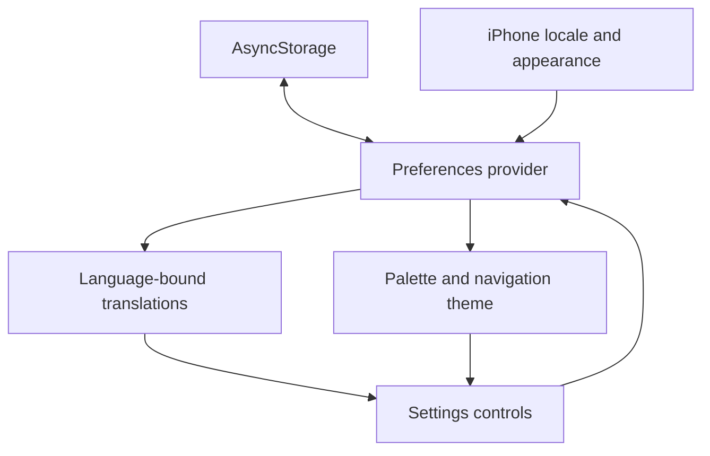

# App Preferences

Settings adds system/English/Ukrainian language selection and system/light/dark appearance. Choices apply immediately to the interface and are stored locally. This milestone does not add Mac connectivity or change the preview timer into a running timer.

## Ownership and Data Flow



| Location                                  | Responsibility                                                                                            |
| ----------------------------------------- | --------------------------------------------------------------------------------------------------------- |
| `src/preferences/model.ts`                | Define preference types, validate stored data, and resolve system defaults                                |
| `src/preferences/storage.ts`              | Read the namespaced record and serialize writes through an injected storage interface                     |
| `src/preferences/context.tsx`             | Restore preferences before rendering screens, expose immediate updates, and report persistence status     |
| `src/localization/config.ts`              | Register both offline dictionaries and fallback behavior                                                  |
| `src/localization/resources/en.ts`        | English source dictionary and translation-key schema                                                      |
| `src/localization/resources/uk.ts`        | Ukrainian dictionary checked against the English keys                                                     |
| `src/localization/i18next.d.ts`           | Extend i18next with the application resource types                                                        |
| `src/localization/use-app-translation.ts` | Bind translations and VoiceOver language metadata to the resolved preference                              |
| `src/design-system/tokens.ts`             | Define matching light/dark semantic palettes and shared layout tokens                                     |
| `src/design-system/use-theme.ts`          | Expose the active palette and memoize theme-dependent styles                                              |
| `src/features/settings/`                  | Render accessible choices and persistence feedback                                                        |
| `src/app/_layout.tsx`                     | Configure localized native navigation titles, status bar contrast, and startup rendering                  |
| `src/package.json`                        | Declare the source tree as ESM for Node's native TypeScript test support; it is not a workspace package   |
| `tests/`                                  | Exercise preferences, translation completeness/fallback, and text contrast without loading native modules |

All paths in this table are relative to `apps/mobile/`.

## Language Resolution

The stored language choice is `system`, `en`, or `uk`. System mode selects the first supported language from the device's preferred locale list. Unsupported lists fall back to English. The preference remains `system` in storage so the next device-language change can be followed rather than freezing the current result.

`expo-localization` supplies locale information. Its `useLocales` hook is the reactive boundary. Native iOS language changes may restart the application; confirm this behavior in the eventual development build as well as Expo Go.

Both dictionaries are bundled, so translation does not depend on network access. Flat keys use feature prefixes such as `home.title` and `timer.close`; `keySeparator: false` treats each as a complete key. The Ukrainian resource must satisfy the English key schema, and unit tests compare interpolation names and reject empty translations.

`useAppTranslation` uses react-i18next's explicit `lng` option. The resolved preference is the single owner of the active language; components do not mutate or read the global `i18n.language` as an independent setting. Existing preview state remains mounted while Settings is open.

Visible copy, navigation titles, and accessibility labels are translated. App text and controls provide language metadata for VoiceOver. Product names such as YouTube remain proper names. Source identifiers, developer-facing errors, test descriptions, comments, and documentation remain English.

## Appearance

The provider resolves `system`, `light`, or `dark` using React Native's `useColorScheme`. An explicit choice selects a palette without overriding the iPhone's system setting. Returning to System mode follows the current device appearance again.

Light mode uses a dedicated palette rather than a brightness transform. The background, cards, text, accent, illustration, modal overlay, navigation theme, and status bar all respond to the selected mode. Theme-dependent styles are created from the palette and memoized until that palette changes.

`app.json` permits automatic appearance and configures both splash backgrounds. The localization plugin advertises English and Ukrainian and disables RTL layout for the current LTR-only translations. Native plugin behavior and release splash appearance require a custom native build; Expo Go cannot validate every native configuration detail.

## Persistence and Failure Behavior

Only the language and appearance choices are stored under `remote-control.preferences.v1`. The record includes `version: 1`. No authentication credentials, pairing secrets, or device authorization data are written to AsyncStorage. The connected product's credentials will use the planned Keychain boundary.

- Missing or malformed records use system defaults.
- Invalid fields fall back independently; an unsupported schema version uses the complete default record.
- A read failure allows the app to start with defaults and exposes an error status in Settings.
- Each user change updates the interface immediately and queues a serialized snapshot for persistence.
- Writes execute in order. A slow earlier request cannot overwrite a later selection after it has been saved.
- A failed write rejects to the provider, while the internal queue remains usable for later requests.
- A request identifier prevents an older completion from replacing the status of the latest save.
- Settings shows saving/error feedback and offers Save current choices when storage fails.

Preferences are restored before the navigator renders. Native splash calls are best-effort in Expo Go; holding and hiding the release splash must be checked in the custom build. This behavior prevents the application UI from first rendering a different stored language or theme while restoration is pending.

Preview volume, playback state, and timer presets remain temporary screen state. They are not part of the saved preferences.

## Automated Checks

```bash
pnpm test:unit
pnpm check
```

The existing `pnpm check` now runs formatting, ESLint, TypeScript, and the unit tests. The pre-push hook and GitHub Actions already call this command, so they pick up the unit tests without a separate workflow.

The 13 tests use Node's built-in test runner and native TypeScript support in the selected Node.js 24 release. Test files use `.mjs`; imported source files have an explicit ESM scope in `src/package.json`. `allowImportingTsExtensions` is enabled with Expo's inherited `noEmit` setting so pure modules can use explicit `.ts` imports in both Metro and the Node tests.

Tests cover restoration, malformed data, version handling, system resolution, storage failure, sequential writes, queue recovery, dictionary/interpolation completeness, language fallback, and WCAG AA normal-text contrast for the palette pairs used by the UI. The storage tests use an injected fake adapter; they do not certify native AsyncStorage behavior.

ESLint, TypeScript, unit tests, and an iOS JavaScript export passed in the implementation workspace. The maintainer also ran `pnpm check` successfully in the repository: formatting, lint, type checking, and all 13 tests passed.

## Recorded iPhone Checks

The maintainer confirmed the following in Expo Go on 2026-11-14:

| Scenario                                                              | Result                                         |
| --------------------------------------------------------------------- | ---------------------------------------------- |
| Select Ukrainian and inspect Settings and the home screen             | Passed                                         |
| Select Light and inspect the remote interface                         | Passed; appearance confirmed by the maintainer |
| Restart Expo Go with Ukrainian and Light explicitly selected          | Both selections restored                       |
| Select System appearance and change the iPhone between light and dark | App followed the device appearance             |

These records cover the scenarios above on the tested iPhone. VoiceOver, larger text sizes, broader device coverage, system-language changes, and native supported-locales/splash behavior remain on the checklist below.

## Device Checklist

- Open Settings from both the home and preview screens.
- Switch English to Ukrainian and check home, guide, preview, timer picker, navigation titles, and VoiceOver labels.
- Switch back to English and confirm the active selection updates immediately.
- Select Light and Dark; inspect cards, illustration, status bar, navigation, timer picker, and selected controls.
- Select System and change the device appearance; check that the app follows it.
- Choose a language and theme, reload the app, and verify both are restored.
- Change both settings quickly, reload, and verify that the last selections are retained.
- Open Settings from a modified preview and return; confirm the local preview values have not reset.
- Check a smaller iPhone size, larger text, and VoiceOver focus/checked-state announcements.
- Validate native supported locales and splash behavior after the custom development build exists.

The arbitrary-duration timer slider remains a separate planned feature, including 45-minute, 2-hour, and 2-hour-45-minute choices and a Mac-hosted countdown.
