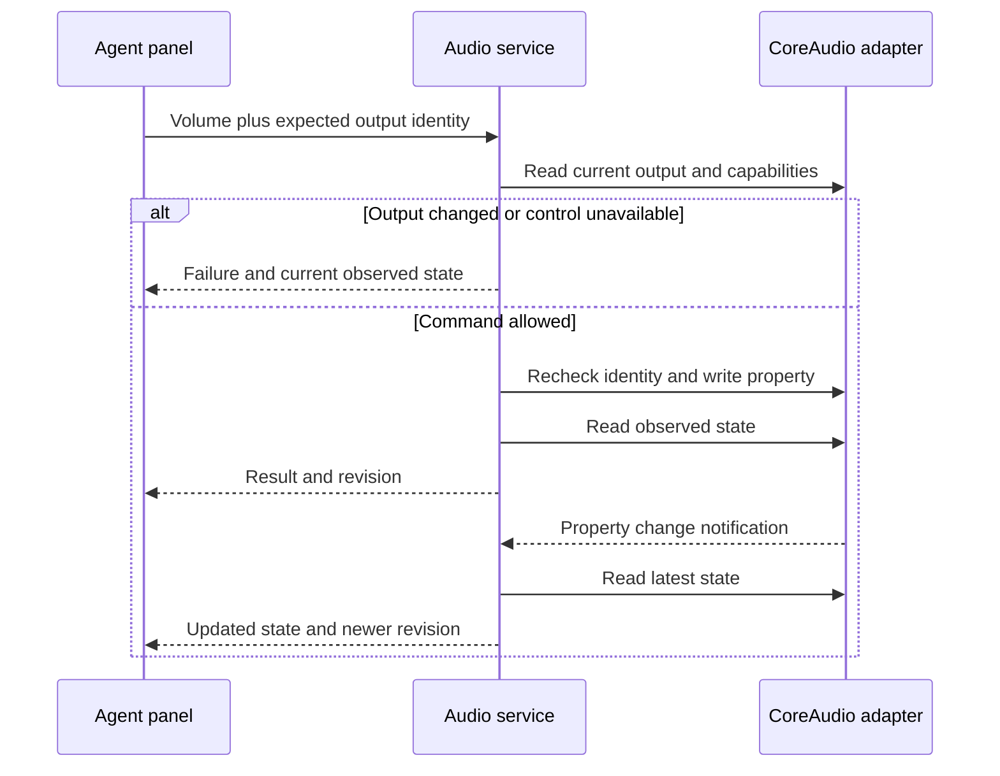

# Local macOS Audio Control

## Scope

This milestone adds local audio controls to the Mac menu-bar Agent: a current output name, volume slider, five-percentage-point adjustments, mute/unmute, refresh, capability states, and error feedback. The mobile preview continues to use local sample data. Phone pairing and remote commands remain planned.

On November 19, 2026, a read-only CoreAudio probe on the maintainer's Mac reported `MacBook Pro Speakers`, with writable main volume and mute properties. That verifies property availability on this output. The complete native check subsequently passed, including all 15 Swift tests and the application build. The maintainer confirmed the output display, audible volume changes using the slider and adjustment buttons, mute/unmute preserving volume, and external volume synchronization. After the UI polish build, the spinner and slider tick marks were confirmed removed. Device switching and this feature's CI execution remain unverified.

The implementation workspace compiled `RemoteCore` and passed all 15 Swift Testing tests with Swift 6.0.3 on Linux. Strict Swift formatter lint also passed for the prepared sources. These checks validate portable logic and source formatting; this environment cannot compile SwiftUI/CoreAudio against the macOS SDK. The complete native check has also passed on the maintainer's Mac.

The previous shell milestone passed local build/lifecycle/theme/language checks and both GitHub jobs before its merge into `main` (`673f74e`). The audio results recorded above are separate from that shell baseline.

## Architecture and Ownership

| Boundary              | Implementation                  | Responsibility                                                                     |
| --------------------- | ------------------------------- | ---------------------------------------------------------------------------------- |
| SwiftUI presentation  | `AudioControlCard`              | Render observed state, draft volume, pending writes, capability limits, and errors |
| Application service   | `RemoteCore.AudioOutputService` | Serialize access, validate commands, publish revisions, and own a subscription     |
| Hardware port         | `RemoteCore.AudioHardwarePort`  | Define the testable boundary for hardware operations and notifications             |
| Native adapter        | `CoreAudioHardware`             | Access the default output through public CoreAudio APIs                            |
| Registration lifetime | `AudioPropertyRegistration`     | Pair listener registration with removal using the same block and queue             |

The composition root creates the service and native adapter. The view receives the service as a dependency. `RemoteCore` contains no Apple audio API calls; its tests use a synchronized fake hardware implementation. All hardware reads and writes execute on the service actor rather than the main UI actor.



## Command Safety

- Volume is a finite scalar in `0...1`. The core constructor rejects invalid input rather than silently converting it.
- UI commands carry both the observed HAL object ID and UID. This also detects object ID reuse for another output.
- The service checks the current output and capability before calling the adapter. The adapter checks the identity and property writability again at its write boundary.
- Each command writes one main-element property. There are no per-channel writes, automatic device selection, or write retries.
- Mute is a separate Boolean property. Changing mute preserves the stored volume; setting volume does not implicitly unmute.
- A command failure is returned alongside a fresh readback. Read failures clear usable UI state rather than displaying an invented zero volume.
- CoreAudio routing and writes are separate OS operations. A routing change in that small interval can still affect the former device; the implementation never retargets the command to the newly selected device.
- HAL setters may settle asynchronously and drivers can quantize volume. The UI shows observed hardware values and follows subsequent notifications. A setter returning successfully is not a guarantee that the requested value has already become the observed value.

The adapter reads the public main-element `kAudioDevicePropertyVolumeScalar` and `kAudioDevicePropertyMute` selectors. The maintainer's probe confirms these properties for the built-in speakers. An output exposing only virtual or individual-channel controls is reported as unsupported for the missing control in this milestone. A broader strategy requires device-specific validation before introducing channel or balance behavior.

The code uses CoreAudio's Swift HAL wrapper, available from the existing macOS 15 target. Raw property payloads are length-checked and loaded without alignment assumptions. The adapter does not open audio streams, record sound, install drivers, invoke shell commands, or request Accessibility access.

## Observation and UI Behavior

The adapter subscribes to the default-output property and supported volume, mute, device-alive, name, and owned-object properties. It also subscribes to service restart notifications when the system advertises that property. A default-output change causes the service to replace device registrations; a service restart forces registration renewal.

Streams buffer only the newest published state. Monotonic revisions prevent an older command result from overwriting a newer observed snapshot in the panel. Registration tokens remove native listeners on cancellation and final release. The real driver cleanup and notification paths remain part of manual native validation.

Slider and repeated adjustment proposals are coalesced for 75 milliseconds before submission. The slider and percentage show the pending draft without a spinner or a changing status label. The native slider uses a continuous range to avoid automatic tick marks; its binding rounds proposals to 1% increments. The panel disables conflicting controls during the write and restores hardware readback afterward. Initial loading and actionable errors remain visible. Closing the panel cancels pending UI actions. Actions already submitted to the OS cannot be rolled back by cancelling a Swift task.

The volume and mute capabilities are independent. A read-only volume remains visible with a disabled slider; an unsupported volume is explained without hiding a supported mute control. Refresh replaces the observation subscription and retries reading the current output.

The panel scrolls while keeping the Quit control in a fixed footer. English and Ukrainian copy is supplied through the native String Catalog. Language, appearance, keyboard interaction, and text wrapping need another check for the expanded panel.

## Build and CI

The XcodeGen project references `packages/remote-core` as a local Swift package. No external Swift dependency is introduced.

```bash
make -C apps/macos check
pnpm check
```

The native check now runs strict Swift lint, all core tests, project generation, and a Debug application build. The existing pnpm command retains repository formatting and the 13 mobile unit tests. Core tests use fake hardware and make no changes to system sound.

The macOS workflow now watches `packages/remote-core/**` alongside the Agent sources and its own workflow file. It runs the same native check. The Ubuntu and macOS jobs remain separate; native build status is still not an unconditional required branch-protection check.

## Recorded Validation

On November 19, 2026:

- `make -C apps/macos check` passed before and after the UI polish: strict Swift lint, 15 core tests, project generation, and native compilation.
- The new Agent launched and displayed the output and volume on MacBook Pro Speakers.
- The slider and adjustment buttons changed the actual sound level.
- Mute/unmute preserved the selected volume.
- External volume changes updated the open panel automatically.
- The transient spinner and automatic slider tick marks were removed and checked in the running app.
- `pnpm check` passed formatting, lint, TypeScript, and all 13 mobile tests.
- `git diff --check` passed. The reported Git status contained source/documentation changes and no generated Xcode project or build output.

## Deferred UI Polish

The maintainer observed brief visual flicker in the Mute and Refresh buttons during volume updates after the spinner removal. Their appearance currently follows the short-lived disabled state used to prevent conflicting actions. In a future update, keep their appearance stable during routine writes while preserving command coordination and capability/error behavior. This issue is deferred at the maintainer's request; it is not fixed in this milestone.

## Manual Validation Still Required

- Check external mute changes and any driver-specific volume rounding.
- Switch output devices and verify the output label, capability states, and subscriptions follow the new output.
- Confirm unsupported controls remain unavailable rather than appearing successful.
- Close/reopen the panel and quit/relaunch the app, including while a volume proposal is pending.
- Verify English/Ukrainian wrapping, light/dark appearance, keyboard controls, and VoiceOver labels.
- Observe both CI jobs on this feature branch.

Record exact outcomes after each observed check. A passing fake-hardware test does not establish CoreAudio correctness on every device.

## References

- [Apple AudioHardwareSystem](https://developer.apple.com/documentation/coreaudio/audiohardwaresystem)
- [Apple AudioHardwareObject](https://developer.apple.com/documentation/coreaudio/audiohardwareobject)
- [Apple AudioObjectGetPropertyData](<https://developer.apple.com/documentation/coreaudio/audioobjectgetpropertydata(_:_:_:_:_:_:)>)
- [Apple main volume property](https://developer.apple.com/documentation/coreaudio/kaudiodevicepropertyvolumescalar)
- [Apple mute property](https://developer.apple.com/documentation/coreaudio/kaudiodevicepropertymute)
- [Apple property listener registration](<https://developer.apple.com/documentation/coreaudio/audioobjectaddpropertylistenerblock(_:_:_:_:)>)
- [Apple property listener removal](<https://developer.apple.com/documentation/coreaudio/audioobjectremovepropertylistenerblock(_:_:_:_:)>)
