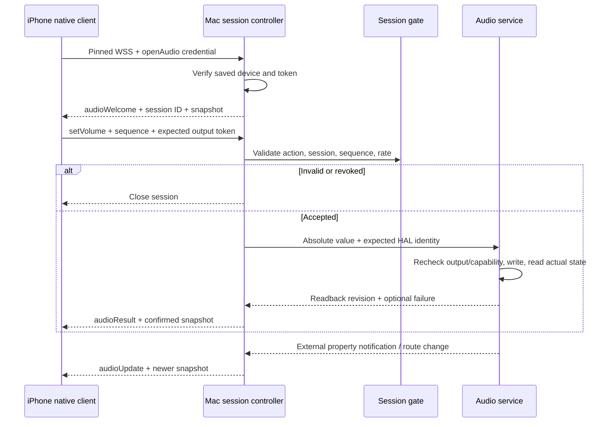

# Authenticated Remote Audio

## Status and Scope

Prepared against `main` at `74b1da6` on November 22, 2026. The preceding secure-pairing PR passed both CI jobs and was merged. This update connects the iPhone's real audio screen to the Mac's existing CoreAudio service. The preview remains an independent sample interface.

Implemented in source: a persistent authenticated WSS session, initial state snapshot, pushed changes, absolute volume/mute commands, independent capabilities, output-identity validation, revocation, bounded queues, heartbeat/deadlines, and explicit reconnect. Also included: separate Mac connection/start and pairing actions, saved-versus-active device labels, and stable Mute/Refresh presentation in the local Mac card.

Implementation-workspace validation passed formatting, ESLint, TypeScript, 23 mobile tests, and 42 portable Swift tests (17 core and 25 protocol tests). Expo also produced the iOS JavaScript/Hermes bundle successfully (1,219 modules); this is not a native Apple compilation result. The three Apple crypto tests are excluded on Linux; the maintainer passed the complete 45-test suite on the Mac. The maintainer subsequently passed the native Mac check (45 Swift tests and Debug build), launched the signed Agent, rebuilt/launched the physical iOS app, and verified volume/mute, external-state synchronization, and use with the Mac panel closed. The maintainer also reported the JavaScript-only slider/zero-volume follow-up working, verified Stop/Start recovery after reopening the remote route, and confirmed active-session revocation, rejected reconnect, and successful re-pairing. The maintainer subsequently passed final `pnpm check` with all 23 mobile tests and both feature CI jobs; the feature was merged as `4d11376`. Broader device/failure coverage remains pending.

## Build and First Run

No dependency installation, app identifier change, Keychain reset, or re-pairing is required when the existing saved credential and network address remain valid. The native Expo module changed, so rebuild the iPhone development binary; Metro reload alone cannot add its new methods.

From the repository root:

```bash
pnpm check
make -C apps/macos format
make -C apps/macos check
```

Use the existing ignored `apps/macos/Signing.local.xcconfig` for the working Apple team. Quit any old Agent before launching the signed runtime:

```bash
make -C apps/macos run
```

Regenerate and compile the physical iPhone development build through Expo:

```bash
pnpm --dir apps/mobile exec expo prebuild --platform ios
pnpm --dir apps/mobile exec expo run:ios --device
```

Open the Mac menu and select **Start connections**. This starts the listener without creating a QR. If access is already saved, select **Control Mac audio** on the phone. For a new phone, select **Pair an iPhone** on the Mac, complete the existing QR/approval flow, then open Mac audio.

Keep both devices on the same reachable private IPv4 network. Stop connections before changing the Mac's selected address. Automatic address relocation and Bonjour discovery remain planned. Older development binaries show the rebuild explanation instead of calling missing audio methods; the pairing/preview flows remain available.

## Source Ownership

| File or directory                                                             | Responsibility                                                                                                 |
| ----------------------------------------------------------------------------- | -------------------------------------------------------------------------------------------------------------- |
| `packages/remote-link/Sources/RemotePairing/RemoteAudioWire.swift`            | Versioned audio DTOs, bounded decoding, argument shapes, capability validation, session sequence and rate gate |
| `packages/remote-link/apple/PinnedTransport.swift`                            | Shared pinned TLS policy, redirect rejection, WebSocket creation, bounded receive deadline                     |
| `packages/remote-link/apple/PairingClient.swift`                              | Existing onboarding and short saved-access verification; reuses the shared TLS boundary                        |
| `packages/remote-link/apple/RemoteAudioClient.swift`                          | Native foreground session, cached snapshots, matching command replies, heartbeat, deadlines, cancellation      |
| `packages/remote-link/apple/RemoteLinkModule.swift`                           | Capability version and typed Expo functions; native background/destruction cleanup                             |
| `packages/remote-link/src/index.ts`                                           | Optional module loading, capability detection, typed API                                                       |
| `apps/macos/Sources/RemoteControlAgent/Pairing/PairingController.swift`       | Listener, credential verification, peer/session ownership, dispatch gate, bounded sending, revocation          |
| `apps/macos/Sources/RemoteControlAgent/Audio/RemoteAudioBroker.swift`         | Confirmed-state mapping, opaque output token, service dispatch, revision ordering                              |
| `packages/remote-core/Sources/RemoteCore/AudioOutputService.swift`            | Serialized HAL access, identity/capability checks, readback, independent subscribers sharing one observer      |
| `apps/mobile/src/features/remote-audio/model/audio-state.ts`                  | Runtime validation of native summaries, stale-session rejection, revision merge                                |
| `apps/mobile/src/features/remote-audio/model/use-remote-audio.ts`             | Focus/background lifetime, one UI write at a time, cache reads, explicit reconnect                             |
| `apps/mobile/src/features/remote-audio/components/audio-output-card.tsx`      | Own the output-keyed drag draft, immediate percentage, confirmed/applying labels, and control actions          |
| `apps/mobile/src/features/remote-audio/model/volume.ts`                       | Percentage steps, exact endpoints, silent-state presentation, and slider coordinate mapping                    |
| `apps/mobile/src/features/remote-audio/components/volume-slider.tsx`          | Local drag draft, release-to-commit, bounded levels and accessibility actions                                  |
| `apps/mobile/src/features/remote-audio/screens/remote-audio-screen.tsx`       | Confirmed percentage, output name, capabilities, session/error UI                                              |
| `apps/mobile/src/app/remote.tsx`                                              | Thin Expo Router route entry                                                                                   |
| `packages/remote-link/Tests/RemotePairingTests/Fixtures/remote-audio-v1.json` | Non-secret boundary fixture consumed by Swift and TypeScript tests                                             |

## Session and Command Path



Pairing and remote audio use the same listener, port, identity, and TLS pin. `authenticate` retains its short verification-and-close behavior. `openAudio` requests a distinct persistent session. Before authentication, audio command frames are not accepted. The server generates a fresh session UUID after checking the saved device/token; the UUID is a correlation boundary, not a replacement for authentication.

The original audio allowlist contains `setVolume`, `setMuted`, and `refreshAudio`. The later [YouTube increment](youtube-control.md) adds target-bound absolute `setPlayback` to the same authenticated foreground session. Volume is an absolute finite scalar in `0...1`; mute is an absolute boolean. Each command carries the session ID, a request UUID, and the next sequence number. Writes also require the current opaque output token. Unknown actions/fields, unsupported versions, unexpected argument combinations, binary frames, mismatched sessions, duplicate/out-of-order sequences, or excessive rates close the connection before dispatch.

The rate gate allows a burst of ten requests and replenishes ten tokens per second using `ContinuousClock`. The audio baseline used a global three-peer cap. The selected-YouTube increment raises the total to four to allow one browser peer; see [YouTube control](youtube-control.md). No command is retried automatically. Queues are bounded: one command in flight, at most two queued replies, and one replaceable latest snapshot per Mac peer.

## Confirmed State and Hardware Safety

The Mac publishes observed state, never the requested value as a substitute for readback. HAL can settle asynchronously; an immediate result may still show the old value, followed by a newer property notification. Each snapshot has an increasing revision. Native and TypeScript consumers keep newer confirmed state when an earlier readback arrives late.

The broker maps the actual `AudioOutputID` to an opaque UUID. A route change or failed read invalidates that token. The Mac retains HAL object ID and device UID locally. Both the service and the CoreAudio adapter validate the expected hardware identity; switching headphones cannot retarget an old speaker command onto a new output.

Volume and mute capabilities are independent. Unsupported/read-only volume does not disable writable mute, and unsupported mute does not disable writable volume. Muting preserves the stored volume level. The displayed percentage is the actual gain value even while muted; mute state is shown separately.

The audio card owns a local drag draft, so its track and large percentage update together while the finger moves. The caption identifies this as a pending choice, then an applying state. One absolute command is sent on release. After it completes, the draft clears and the number returns to confirmed Mac state; a route change discards the keyed card and its draft. Ordinary controls show no per-command spinner. Rapid additional taps while a command is in flight are ignored rather than queued for later execution. The Mac Mute/Refresh buttons retain their appearance during brief writes while their handlers still prevent conflicting actions.

Buttons and VoiceOver steps use integer percentage arithmetic. A Float32 HAL readback for 5% can be slightly above `0.05`; direct subtraction would leave a positive residue displayed as 0%. The new helper rounds to the percentage grid before stepping and sends exact `0`/`1` at the boundaries. Exact zero uses the silent icon even if the independent hardware mute flag is false. Positive sub-percent readback is labelled `<1%`, never `0%`. The zero fix must be checked audibly on the original output; other output devices can have different minimum-gain behavior.

`AudioOutputService.updates()` now provides independent subscriptions through a single native hardware observation. Cancelling the menu panel's stream does not stop the transport's stream. Cancelling the final subscriber removes the native observation. Application shutdown explicitly stops all streams.

## Native Client and Lifecycle

TLS pinning, saved credentials, sockets, command correlation, and the receiver stay native. JavaScript receives an owner label, confirmed snapshots, and fixed failure codes. It never receives the token, certificate, private key, or hardware UID.

The native receiver consumes pushed `audioUpdate` frames continuously. React reads that native cache every 500 ms only while the remote route is focused; this is not a network polling interval. Repeated identical cache reads keep the same React state object. The native client sends a `refreshAudio` heartbeat every ten seconds when no other command is pending. A user write waits for an in-flight heartbeat instead of failing due to that internal request.

Connection setup and command results have eight-second deadlines. The receiver has a 25-second no-message deadline; the Mac closes a session after 35 seconds without a command/heartbeat. Cancellation also closes the WebSocket and invalidates its ephemeral URLSession. The session's resource timeout is bounded to one day; long sessions reconnect explicitly after closure.

Leaving the remote route or entering the background closes the phone's session. Native `OnAppEntersBackground` cleanup supplements the React listener. Returning to the foreground offers explicit reconnect. Returning to a focused route can create a fresh session, but no previous command is replayed. Lifecycle owner labels prevent old cleanup/results from changing a newer connection; they are not authentication credentials.

## Revocation and Failure Semantics

The Mac persists a revocation before updating its device list and closing that device's active peers. Closing a peer cancels its pending task. The audio service checks cancellation immediately before entering its synchronous write. A write already executing at the hardware boundary can finish; revocation does not undo it. Subsequent authentication/commands are rejected.

A lost reply leaves the outcome uncertain. The phone clears its active-state UI and explains that the change may already have happened. Explicit reconnect authenticates again and reads a fresh snapshot. It does not replay volume steps or mute operations. A command failure with a valid reply is shown alongside the actual readback; transport/protocol failures close the session.

Stopping connections closes all peers and the broker subscription without deleting paired credentials or disabling local Mac audio. Starting connections after an Agent restart restores listener availability without generating a QR or pretending the saved device list is an active connection list.

## Validation

Implemented automated checks cover:

- Invalid/non-finite volume values, independent capability states, hardware failures, quantized readback, output changes at both service and write boundaries, and cancellation.
- Multiple subscribers, cancellation of one subscriber without disrupting another, one underlying observer, and global shutdown.
- Session binding, strict sequencing, duplicates, rate replenishment, allowed command shapes, unknown actions/fields, message size/version bounds, and response-versus-command separation.
- Shared Swift/TypeScript fixtures, malformed native summaries, unsafe revisions, stale owners, stale readback, and stable identical cache reads.

The Linux workspace also type-checked the actor client logic using FoundationNetworking plus platform stubs, and the broker against the actual portable packages. That is an additional syntax/concurrency check, not an Apple SDK build, a Keychain test, or a TLS interoperability test. The full Mac check compiles the real Apple client target and Agent; an iOS build separately compiles the Expo bridge.

### Recorded Physical-device Results: November 22, 2026

| Scenario                                  | Observed result                                                                                    |
| ----------------------------------------- | -------------------------------------------------------------------------------------------------- |
| Initial mobile checks                     | Formatting, ESLint, TypeScript, and 19 mobile tests passed before the UI follow-up                 |
| Complete native Mac check                 | Strict Swift lint, 45 Swift tests, project generation, and Debug build passed                      |
| Signed Mac runtime                        | Built, verified, launched, and opened the updated Agent                                            |
| Connection controls                       | Start connections enabled the listener without a QR; the saved phone initially showed Saved access |
| Updated iOS app                           | Expo prebuild and physical-device compilation/install/launch completed                             |
| Phone volume control                      | The maintainer confirmed actual Mac volume changed                                                 |
| Mute/unmute                               | Sound stopped/returned while preserving volume                                                     |
| External volume synchronization           | Mac keyboard changes automatically updated the iPhone                                              |
| Closed Mac panel                          | Phone control continued; the panel was already closed during normal use                            |
| Slider/zero UI follow-up                  | The maintainer reported the follow-up working after applying the JavaScript update                 |
| Stop connections                          | The phone showed Disconnected and its audio controls disappeared                                   |
| Start connections and reopen remote route | A fresh session worked with saved access and no new QR                                             |
| Revoke an active phone                    | The active session closed and reconnect was rejected                                               |
| Re-pair after revocation                  | New access restored volume control                                                                 |

During the Stop/Start check, the maintainer left and reopened the remote route. Its focus handler starts a fresh session, so no Reconnect button press was required. This is not evidence that a disconnected screen reconnects automatically while remaining focused, or that any old command is replayed.

The UI follow-up result is a maintainer-reported smoke check, not an instrumented audio-level measurement or coverage of other output devices.

### Remaining Validation

- Completed before merge: final `pnpm check` passed all 23 mobile tests and both feature CI jobs passed.
- Check VoiceOver actions, keyboard use, large text, both languages/themes, and the Mac Mute/Refresh button appearance explicitly.
- Switch outputs during a drag or command; cover unsupported/read-only controls and additional audio devices.
- Exercise Agent quit/relaunch, Wi-Fi loss, phone lock/background, and a lost pending-command reply. Confirm fresh state and no automatic write replay.
- Exercise a slow peer, rapid input, heartbeat/write overlap, and multiple authorized phones.

## Remaining Boundaries

Discovery/address relocation, arbitrary-duration timers, brightness, touchpad and power remain separate milestones. Selected media/browser integration is covered by the subsequent [YouTube increment](youtube-control.md). Permissions for one action category must not imply permission to execute another. This feature is an audio-only contract and has not undergone a security audit or broad device/OS compatibility test.

## Slider and Zero-volume Follow-up

The maintainer reported that the percentage did not follow a drag, and decreasing by buttons could display zero while faint audio remained. The first issue came from keeping the draft only inside the track component. The second has a reproducible numeric cause: `Math.fround(0.05) - 0.05` is positive rather than zero. The follow-up extracts an output card and shared volume helpers, keeps draft/confirmed labels explicit, and adds four regression tests. These changes touch JavaScript, translations, tests, and documentation only; Metro reload is sufficient with the already rebuilt audio-capable native app.

The maintainer reported this follow-up working. Future device checks should retain coverage of the held-drag number, release-to-apply, exact silence at zero using both controls, the silent icon, and increase from zero. If exact-zero readback remains audible, investigate the output's HAL zero/minimum-gain behavior rather than hiding it by rounding the display.

If a newly added route is missing from TypeScript's generated route union, restart `expo start --dev-client` once to refresh the ignored route types before running `pnpm check`. Do not cast the route to bypass validation or hand-edit the generated declaration.
