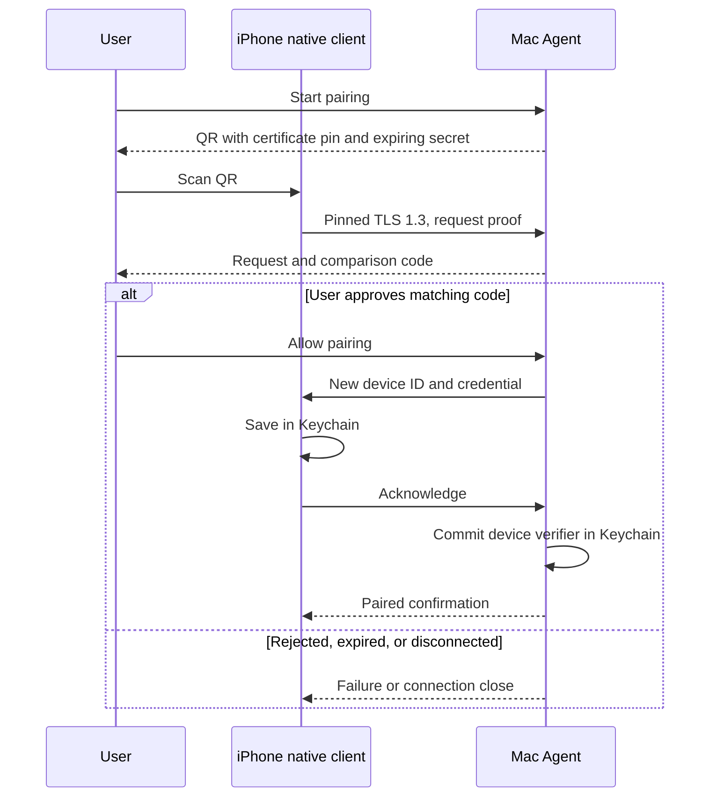

# Secure Local Pairing

## Scope and Current Status

This milestone implements pairing and verification of saved access between the iOS development app and the Mac Agent. It does not yet route volume, playback, timer, or power commands from the phone. The existing remote preview remains explicitly separate from a live remote session.

The implementation is based on repository baseline `3fb0bd9`. On November 20, 2026, the maintainer verified the primary physical-device flow: native builds, signed Mac entitlements, QR pairing, saved-access verification after separately restarting each app, revocation rejection, and successful re-pairing. Final local checks passed 15 mobile tests and 33 Swift tests. Feature CI, broader device/network coverage, and the remaining failure-case matrix are separate from these results.

## User Flow

1. On the Mac, open the Agent and choose **Pair an iPhone**. If several private IPv4 addresses are available, select the address reachable from the iPhone.
2. Allow local network access if requested. The listener binds to that private address on TCP port `49322` and presents a QR code valid for two minutes.
3. On the iPhone, choose **Pair with your Mac**, allow the camera and local network permissions, and scan the QR code.
4. Compare the six-digit numbers on the two devices. The Mac shows the requesting name, which is a self-reported label rather than a verified hardware identity. Reject an unexpected request or a different code.
5. Choose **Allow pairing** on the Mac within the connection deadline. The iPhone saves the credential in Keychain and acknowledges receipt. The Mac commits the device record and returns the final confirmation.
6. Use **Verify saved access** to open a new pinned connection and check the saved credential. This is a short verification request; it does not create a continuous remote session.
7. **Revoke** on the Mac removes that phone's access. **Forget this Mac** on the iPhone removes its local credential only; it does not revoke the Mac's record.

The listener continues running after the invitation expires. **Stop connections** closes the listener and outstanding connections without deleting saved device records. Connections must be started explicitly again after restarting the Agent. The fixed port supports verification after restarting the listener at the same address; DHCP address changes require a fresh pairing in this milestone. Bonjour relocation is planned.

## Architecture

| Area                                             | Responsibility                                                                                                       |
| ------------------------------------------------ | -------------------------------------------------------------------------------------------------------------------- |
| `packages/remote-link/Sources/RemotePairing/`    | Shared Swift invitation/frame models, validation, monotonic pairing gate, Apple crypto helpers, and Keychain wrapper |
| `packages/remote-link/apple/`                    | iOS pinned WebSocket client and Expo module; private credentials remain native                                       |
| `packages/remote-link/src/`                      | Small typed JavaScript facade with optional native-module loading                                                    |
| `apps/mobile/src/features/pairing/`              | Camera scan, comparison-code UI, cancellation, saved-access verification, and display-summary validation             |
| `apps/macos/.../Pairing/AgentIdentity.swift`     | Create or restore the Mac's self-signed TLS identity from Keychain                                                   |
| `apps/macos/.../Pairing/PairingController.swift` | Listener lifetime, request bounds, Mac approval, credential persistence, verification, and revocation                |
| `apps/macos/.../Pairing/AgentPairingCard.swift`  | QR rendering, comparison/approval, network selection, and paired-device controls                                     |

`RemoteLink` is both a local Swift package and an Expo workspace module. The Mac and iPhone compile the same protocol source files. CocoaPods compiles the iOS client with those sources; SwiftPM compiles the protocol and its tests. On macOS, SwiftPM also compiles the Foundation/Security client target, providing an additional compile check without requiring an iPhone simulator runtime. The Expo bridge itself is checked by the physical-device development build.

The iOS client is an actor with one active operation. Generation identifiers prevent a late result from completing a newer attempt. The Mac controller is main-actor isolated; Network callbacks return to that actor before touching observable state. Existing audio hardware I/O retains its separate `RemoteCore` actor. No pairing message invokes the audio service.



## Transport and Identity

- Transport is WSS with TLS 1.3 as the minimum at both ends. There is no HTTP, plaintext WebSocket, or certificate-validation fallback.
- The Mac creates a P-256 self-signed leaf using Apple's `swift-certificates` implementation. The private key and certificate are stored in the app-scoped Data Protection Keychain. All identity queries, inserts, and cleanup explicitly select that backend; identity lookup uses `SecItemCopyMatching` with `kSecClassIdentity` and verifies the matching certificate. Generation uses no shell commands, temporary private-key files, system trust profiles, or external CA.
- The certificate has a ten-year lifetime and a server-authentication extended key usage. Automatic identity rotation is not implemented; replacing the identity requires pairing again. A locked, unreadable, or incomplete Keychain identity is an error rather than a reason to silently replace it.
- The QR contains the exact leaf certificate's SHA-256 fingerprint. The native iOS `URLSession` delegate accepts only that leaf, anchors trust evaluation to it, and performs basic X.509 validation. The scanned fingerprint is the server identity; IP/DNS hostname validation is intentionally replaced by that out-of-band identity check. Arbitrary self-signed certificates are rejected.
- The development binary retains Expo's Metro networking configuration. Pairing independently requires WSS, TLS 1.3, and the certificate pin.
- The client refuses HTTP redirects and uses an ephemeral session with no shared URL cache or cookie store. Pairing proof and credentials are sent only after the pinned TLS handshake.
- React Native's ordinary `fetch` and `WebSocket` are not used for this transport: the trust decision stays in native code. Expo Go and older development builds expose an explanatory message and keep the preview usable.

The QR is sensitive onboarding material. Do not log it, commit it, put it in analytics, or share screenshots of an active code. Physical access to a displayed code and an explicit Mac approval are the trust bootstrap; Wi-Fi membership alone grants no access.

## Protocol and Request Bounds

The invitation uses `remotecontrol-pair://v1/` followed by canonical unpadded base64url JSON. Its fields are `version`, `id`, `host`, `port`, `name`, `fingerprint`, `secret`, and `expiresAt` (Unix milliseconds). The random secret contains 256 bits from `SecRandomCopyBytes`.

The initial endpoint accepts only RFC 1918 IPv4 literals and unprivileged ports. This bounds QR-directed connections; it does not make an IP address a trusted identity. IPv6, public addresses, automatic discovery, and network relocation are outside this first pairing milestone.

Requests carry a protocol version, action, and UUID request ID. The pairing proof is HMAC-SHA256 over a versioned context, invitation ID, request ID, and bounded display name. The six-digit comparison is derived from that same request and invitation secret. Names may contain Unicode, but not control characters, and are limited to 80 UTF-8 bytes. The secret is not included in the request frame.

The Mac uses `ContinuousClock` instants, which keep advancing during system sleep, for the authoritative 120-second invitation deadline, including a fresh check at approval. Phone wall time is an early usability check, not the server's security boundary. One valid request reserves the invitation. Approval buttons carry the displayed request and connection IDs, so a stale button cannot approve a replacement request. Approval, rejection, cancellation, replacement, or expiration prevents reuse. Five invalid proofs close the invitation window.

The selected private address and fixed port are supplied once through `NWParameters.requiredLocalEndpoint`. The listener is created with `NWListener(using:)`, without a second port override. The listener permits at most three outstanding connections. Each has a 60-second deadline, including handshake and approval. Text frames are limited to 4096 bytes. Unknown actions/versions, binary frames, malformed frames, incorrect request IDs, and invalid transitions are rejected or disconnected. At most ten paired devices are stored. No pairing action executes arbitrary commands, invokes a shell, or grants a power action.

## Credential Storage and Failure Recovery

The iPhone stores one Mac credential in a non-synchronizing Keychain item with `WhenUnlockedThisDeviceOnly` accessibility. Only display metadata and the comparison code return through the Expo facade; credentials and private TLS trust evaluation do not cross into JavaScript. The scanned QR string necessarily exists briefly in JavaScript camera event memory and is not persisted.

The Mac also stores its device records in the explicitly selected Data Protection Keychain. Its private key and generic credentials use `WhenUnlockedThisDeviceOnly`; the iPhone uses the same policy. Locked or unauthorized storage produces an error without a reset or a fallback to another backend.

The Mac assigns the device UUID and issues a fresh 256-bit token after approval. It persists an HMAC-based token verifier, name, and device ID, rather than the token itself. A later `authenticate` request sends the bearer token inside pinned TLS; CryptoKit verifies it against the saved verifier. Successful verification closes the short-lived connection. It does not authorize any unimplemented remote command.

Pairing is not a distributed atomic transaction. The iPhone saves before acknowledgment; the Mac commits after receiving the acknowledgment and before sending its final reply. A lost final reply may leave valid saved access even though the phone shows an error. **Verify saved access** resolves that case. If the Mac never committed, verification is rejected and the user can forget and pair again. Cancelling an already-submitted operation cannot guarantee rollback on the other device. Storage errors do not produce a successful pairing UI.

The iPhone cancels outstanding work when the screen unmounts or the app enters the background. Secrets are never included in error messages or logs. Debug builds expose a sanitized setup diagnostic containing a fixed operation/stage identifier and a numeric Security or Network status. These diagnostics never serialize arbitrary errors, query dictionaries, QR contents, credentials, certificates, or private keys. Incoming TCP listening itself does not require a local-network access prompt on the Mac; lack of a prompt does not identify the failing step. Revocation affects subsequent authentication immediately; there is no continuous authenticated command session in this milestone.

## Dependencies and Build

`expo-camera` is installed through the SDK-aware Expo installer. `@remote-control/remote-link` is a workspace dependency discovered by Expo Autolinking. The installed Expo CLI does not parse `workspace:*` in `expo install`; the local package is linked through pnpm workspace resolution. SDK dependencies such as `expo-camera` continue to use `expo install`. The module builds from local source. Generated iOS files remain ignored; permissions and localization are configured through `app.json`, the camera plugin, and locale files.

The Mac XcodeGen specification adds the local `RemoteLink` product and exact versions of Apple's `swift-certificates` (1.9.0), `swift-crypto` (3.12.3), and `swift-asn1` (1.3.1). Swift package resolution may download their transitive crypto dependency during the first native build. Existing Node versions and package-manager pins remain unchanged.

```bash
pnpm install --frozen-lockfile
pnpm check
make -C apps/macos check
```

The Mac check includes the existing 15 audio tests and the pairing protocol tests. Apple-only crypto tests and compilation of the Apple client target run on macOS. The macOS workflow watches changes to the new package. `pnpm check` includes the existing mobile tests and two native-summary boundary tests; it does not compile the Expo Swift bridge.

### Mac Signing for Pairing

On November 20, 2026, the maintainer passed the native check after the Swift Testing macro correction. Starting pairing then failed at `identity.save-private-key` with OSStatus `-34018` (`errSecMissingEntitlement`). Inspection of the built ad-hoc app showed only `com.apple.security.get-task-allow`, without an application identifier.

The follow-up adds a `SignedDebug` configuration with automatic Apple Development signing and application/team identifier entitlements. `make development` verifies the built app's Apple-issued signature and reads those entitlements; `make run` then opens that signed bundle. The check/CI `Debug` configuration keeps ad-hoc signing. The signing account is separate from the self-signed P-256 identity used for local TLS.

```bash
make -C apps/macos run DEVELOPMENT_TEAM=YOUR_TEAM_ID
```

For repeated runs, copy `apps/macos/Signing.local.xcconfig.example` to `apps/macos/Signing.local.xcconfig` and fill in the team locally. Git ignores that file. The generated Xcode project's Run action uses `SignedDebug`; its optional xcconfig include preserves the local team across project regeneration. No team ID, signing certificate, private signing key, account token, or provisioning profile is committed.

Use an account/team available in Xcode Settings, and ensure its Apple Development certificate has a usable private key. Automatic provisioning may require account authentication or account-specific setup. A certificate subject alone does not establish that the matching private key is present or that the account can provision a new Mac app.

Quit the previously running Agent before opening the signed copy. Opening another bundle with the same identifier may otherwise activate the old process. Confirm the entitlements of the signed output with the current codesign syntax:

```bash
codesign -d --entitlements - --xml \
  apps/macos/build/DerivedData/Build/Products/SignedDebug/RemoteControlAgent.app
```

The maintainer subsequently compiled SignedDebug, passed the Apple-signature check, read valid application/team identifier entitlements, and completed QR creation and persistent saved-access checks on the Mac. An ad-hoc build succeeding does not establish those runtime properties. This change does not delete existing Keychain items or automatically migrate items from a different backend or signing team.

A new iOS development binary is required for the native module and permission changes. Regenerate through Expo, retaining the existing app identifier and signing setup. Do not edit generated iOS files by hand or require a simulator runtime for the physical iPhone workflow.

## Checks Completed in the Implementation Workspace

On November 20, 2026:

- `pnpm check` passed formatting, ESLint for mobile and the facade, TypeScript, and all 15 mobile tests.
- Swift 6.0.3/Linux passed all 15 existing audio tests and all 15 portable pairing tests with warnings treated as errors.
- Strict Swift formatter lint passed for the prepared native/shared sources.
- Expo Autolinking resolved the workspace pod, Swift module, and `RemoteLinkModule` registration.
- Expo iOS prebuild completed without CocoaPods installation. Generated camera/local-network permission keys, absence of a microphone prompt, and both locale files were checked. This is project generation, not an iOS compilation result.
- The exact certificate-builder source compiled in a separate Linux probe using the selected Apple X.509/crypto/ASN.1 versions. Certificate/public-key round-trip and OpenSSL self-signature/server-purpose validation passed. This does not validate Apple Keychain identity lookup or Network framework interoperability.

The maintainer subsequently completed the native build/signing and primary device checks recorded below. The original Linux checks did not replace those Mac/iPhone checks.

## Recorded Device Validation: 2026-11-20

| Check                                                        | Observed result                                                                                                                   |
| ------------------------------------------------------------ | --------------------------------------------------------------------------------------------------------------------------------- |
| `pnpm check` on the maintainer's Mac                         | Passed formatting, both ESLint scopes, TypeScript, and all 15 mobile tests                                                        |
| `make -C apps/macos check`                                   | Passed strict Swift formatting, all 15 audio tests, all 18 pairing/Apple crypto tests, project generation, and native Debug build |
| SignedDebug build and Apple signature verification           | Passed; built application and team identifier entitlements were read successfully                                                 |
| Local team selection                                         | Created the ignored `Signing.local.xcconfig`; team values remain outside tracked source                                           |
| Updated physical iOS development app                         | Prebuild and CocoaPods completed; app compiled/installed and launched                                                             |
| QR pairing with Mac approval                                 | Completed; saved Mac appeared on the iPhone                                                                                       |
| Verify saved access                                          | Mac accepted the saved credential through a fresh connection                                                                      |
| Restart the iPhone app, then verify                          | Saved Mac restored and verification succeeded                                                                                     |
| Quit/relaunch the Mac Agent, start its listener, then verify | Saved device/identity restored and verification succeeded                                                                         |
| Revoke the phone on the Mac, then verify on iPhone           | Verification was rejected                                                                                                         |
| Pair again and verify                                        | Succeeded with newly issued access                                                                                                |

The final checks ran after the Keychain/signing, XML entitlement-output, and listener-initialization corrections. These results establish the tested workflow on the maintainer's devices, not a full security audit or an OS/network compatibility matrix.

## Remaining Validation

- Completed after the recorded device checks: both pairing CI jobs passed before merge. Current remote-audio CI and its new device matrix remain pending.
- Check permission prompts and text wrapping in both languages, light/dark appearance, keyboard use, and VoiceOver.
- Manually reject a new pairing request, let an invitation expire, reuse an old code, and background/cancel during approval. Portable tests cover gate and input boundaries; the full UI/network paths remain separate checks.
- Stop the listener and verify connection failure while local audio remains usable.
- Exercise network loss, certificate/pin mismatch, a lost final confirmation, locked Keychain, and storage failures on devices.
- Test address changes, multiple interfaces, additional phones, and the minimum configured OS versions.

## Deferred Interface Improvements

- Separate **Start/Stop connections** from **Pair an iPhone**. The current pairing button both starts the listener and creates an invitation.
- Label the stored list as **Paired devices** and show the listener's state separately. A saved phone entry must not imply an active connection. Continuous authenticated command sessions are not implemented in this milestone.
- Keep pairing, saved access, verification, and an eventual active remote session visually distinct. The maintainer encountered ambiguity in the Mac panel during the restart check.
- The previously recorded Mute/Refresh button flicker remains deferred in [macOS Audio Control](macos-audio-control.md).

These follow-ups are addressed in the remote-audio source update and await device verification. The earlier device results above do not establish the behavior of that new UI.

## References

- [Apple: Security certificate identities](https://developer.apple.com/documentation/security/creating-an-identity)
- [Apple: Network WebSocket options](https://developer.apple.com/documentation/network/nwprotocolwebsocket/options)
- [Apple: URLSession TLS configuration](https://developer.apple.com/documentation/foundation/urlsessionconfiguration/tlsminimumsupportedprotocolversion)
- [Apple swift-certificates source](https://github.com/apple/swift-certificates/tree/1.9.0)
- [Expo SDK 58 camera](https://docs.expo.dev/versions/v58.0.0/sdk/camera/)
- [Expo Modules API](https://docs.expo.dev/modules/module-api/)
- [Expo Autolinking](https://docs.expo.dev/modules/autolinking/)
