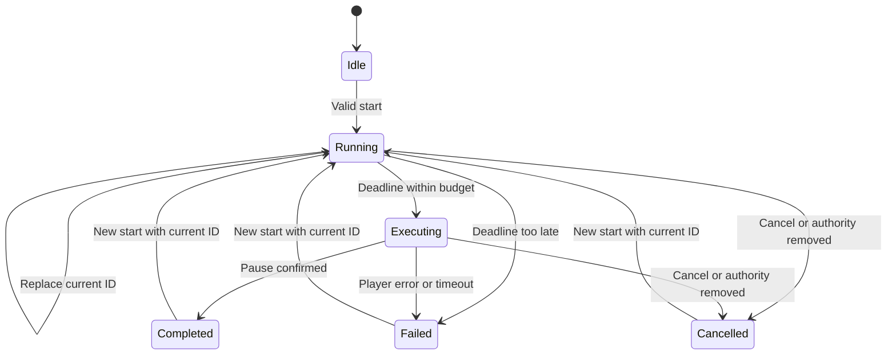

# Mac-Owned Sleep Timer

## Scope and Status

The timer pauses the explicitly selected YouTube document in Chrome after a custom duration. It does not put the Mac to sleep or shut it down. Choose **1–720 minutes**, in one-minute increments, using a slider, +/- controls, or 15/30/60/120-minute shortcuts. For example, **02:45 means 165 minutes**, not a time of day.

Status on November 24, 2026: implemented with portable automated checks; the updated Mac/iPhone builds, real Chrome deadline behavior and feature CI are pending. The previous selected-YouTube feature passed both CI jobs and was merged as `e92bec1`; its primary Pause/Play, synchronization, next-video and tab-close/audio checks passed on the maintainer's devices. Those results do not validate the new timer.

There is one shared timer per Agent, visible to every connected paired phone. Starting or replacing it begins a fresh duration from the Mac's current monotonic time. Reopening the phone remote reads the existing Mac state; it does not start a second timer.

## Behavior

| Event                                                                                              | Result                                                                  |
| -------------------------------------------------------------------------------------------------- | ----------------------------------------------------------------------- |
| Start with a ready selected video                                                                  | Mac starts the countdown; phone shows confirmed state                   |
| Choose 2 h 45 min                                                                                  | Exact 9,900-second duration                                             |
| Phone backgrounded, route closed or app terminated                                                 | Countdown continues on the Mac while the Agent/browser remain available |
| Next video in the same selected document                                                           | Countdown continues; expiration targets the current ready video         |
| Explicitly reselect a tab, even the same tab                                                       | Previous timer is cancelled; review and start a new one                 |
| Close/reload the selected document                                                                 | Timer is cancelled once the document disconnect is reported             |
| Browser helper disconnects / Disable YouTube                                                       | Timer is cancelled                                                      |
| Stop connections                                                                                   | Timer is cancelled before browser/session teardown                      |
| Revoke the creating phone                                                                          | Its timer is cancelled, including after its session has closed          |
| Revoke another phone                                                                               | Timer is unchanged                                                      |
| Another paired phone replaces/cancels                                                              | Current timer identity must match; stale requests are rejected          |
| Expiration with a fresh controllable player                                                        | Exactly one absolute pause request is dispatched                        |
| Advertisement, loading video, stale/frozen page, or another playback command pending at expiration | Timer fails; no blind retry                                             |
| Tick arrives more than 15 seconds late                                                             | Timer fails as `late`; no delayed pause request                         |
| Quit/restart/crash Agent                                                                           | Timer is lost; a new instance is idle                                   |

The Mac must remain awake. `ContinuousClock` is monotonic and advances through machine sleep; elapsed deadlines are never restarted from a remaining duration. This increment has no wake lock, sleep notification handler, persisted schedule or launch-at-login recovery. A short suspension within the 15-second lateness budget may still allow a fresh player to be paused. A longer delay is a terminal failure. Wall-clock/date/timezone changes do not reschedule the timer.

## Architecture and Source Ownership

| File / area                                                              | Responsibility                                                                          |
| ------------------------------------------------------------------------ | --------------------------------------------------------------------------------------- |
| `packages/remote-core/Sources/RemoteCore/SleepTimerModels.swift`         | Duration limits, immutable domain state, typed cancellation/failure reasons             |
| `SleepTimerMachine.swift` in the same directory                          | Pure ownership/deadline/generation state machine, with explicit test time               |
| `apps/macos/Sources/RemoteControlAgent/Timer/SleepTimerController.swift` | Main-actor scheduling, media preconditions, one expiration action and confirmed result  |
| `SleepTimerStatusCard.swift` in the same directory                       | EN/UK Mac status, stable countdown and cancel action                                    |
| `Browser/YouTubeService.swift`                                           | Selected-document identity, monotonic player freshness and target-bound playback        |
| `Audio/RemoteAudioBroker.swift`                                          | Composite audio/media/timer state under one increasing revision                         |
| `Pairing/PairingController.swift`                                        | Existing authentication, per-session admission, owner identity and revoke/stop hooks    |
| `packages/remote-link/Sources/RemotePairing/SleepTimerWire.swift`        | Timer DTO and semantic validation                                                       |
| `RemoteAudioWire.swift` in the same directory                            | Separate start/cancel command shapes on the authenticated session                       |
| `packages/remote-link/apple/RemoteAudioClient.swift`                     | Native command correlation, deadlines and confirmed snapshot cache                      |
| `packages/remote-link/src/timer.ts`                                      | Framework-free timer contract, parser and duration constants                            |
| `apps/browser-extension/src/content.ts`                                  | Fresh `selectionID` per explicit selected document; stable across SPA video changes     |
| `apps/mobile/src/features/sleep-timer/`                                  | Duration draft, accessible slider, presets, confirmed-state card and stale editor guard |
| `apps/mobile/tests/sleep-timer.test.mjs`                                 | Mobile boundary fixture, invalid data, exact duration and revision behavior             |

The timer domain has no UI, network, browser or hardware dependency. The Mac controller performs I/O. A deterministic domain tick emits an expiration value rather than pausing a browser itself. Existing transport names still contain `Audio` for compatibility, but their snapshot now composes independent output, media and timer state.



### Two Identities

`selectionID` identifies an explicit document selection. `targetID` identifies the actual HTML video target and changes on next-video navigation or video element replacement. The timer stores the selection, then obtains the current target at expiration. It never saves a video ID and tries to apply that old target to a new video.

The extension generates both identities with UUIDs. Swift/TypeScript normalize UUID text consistently; the case-sensitive YouTube video ID remains unchanged. Clearing a selection sends no selection identity. A new explicit selection creates a new adapter and selection UUID, even when selecting the same tab.

### Deadlines and Completion

The state machine stores a `ContinuousClock.Instant` deadline. A one-second task ticks the machine, which computes the ceiling of the remaining duration; it never decrements a counter and accumulates scheduling drift. No zero is shown before expiration. Terminal/executing states have zero remaining seconds.

Only a transition from `running` to `executing` emits an expiration. The controller rechecks document identity and player freshness immediately before calling the existing absolute `setPaused(true, target:)` path. The existing ordered state/readback and result checks determine success. A missing acknowledgment can mean the browser action happened; the timer reports a failure and does not retry automatically.

Each start creates a new timer UUID. Cancel/replace requires the caller's last observed ID, including the retained ID of a terminal timer. A stale editor cannot silently replace a newer timer. Completion is accepted only for the current executing UUID, so a cancelled/replaced task cannot overwrite the new schedule. Cancellation cannot undo a pause already delivered to Chrome.

## Security and Resource Limits

- Commands use the existing native saved-token authentication and pinned TLS session. There is no public HTTP timer endpoint and no JavaScript credential storage.
- `startSleepTimer` permits only selection UUID, integer minutes (1–720) and optional expected timer UUID. `cancelSleepTimer` permits only the expected timer UUID. Audio/playback arguments cannot accompany either command.
- Existing session IDs, strictly increasing sequences, bounded frames, one in-flight phone command and 10 requests/second with a burst of 10 still apply.
- The server obtains the creating device ID from the authenticated peer, never from a phone argument. The owner stays on the Mac and is not included in snapshots.
- The browser role can report selected media/results. It cannot start/cancel timers, control audio, or invoke power/shell actions.
- One countdown task and at most one expiry playback request exist per Agent. No schedule or command replay queue is persisted.
- State changes and countdown updates use the existing bounded/coalesced broadcast path. Native cache reads from React are not additional network commands.
- Revocation cancels a timer owned by that device even when the phone has already disconnected. Simply closing a session does not revoke the timer.

## Mobile Interaction

The connected remote displays a separate timer card. Countdown values come from the Mac; slider changes are local drafts. Apply issues one command. Changing media availability can disable Apply; changing selection or timer identity while the picker is open makes it stale and asks the user to reopen it. Cancel remains available for an active timer even when the player is temporarily not ready.

The picker displays HH:MM, a 48-point slider interaction area, labelled adjustable actions, one-minute increment/decrement buttons and wrapping presets. English/Ukrainian copy follows the existing typed translation setup; colors follow both existing palettes. Dynamic Type, VoiceOver, small-screen and real touch behavior still require device review. No spinner is inserted on each countdown update.

The separate **Remote preview** remains a simulation with presets and no real countdown. Use the connected **Mac remote** for this feature.

## Upgrade and Run

All participants must be updated together: Agent, Native Messaging helper, unpacked extension and native iPhone binary. A Metro reload alone cannot add the new Expo methods.

From the repository root, first install using the existing lockfile and check changes:

```bash
pnpm install --frozen-lockfile
pnpm --dir apps/mobile exec expo customize tsconfig.json
pnpm check
make -C apps/macos format
make -C apps/macos check
```

Quit the currently running Agent, then launch the updated signed app and rebuild/install the helper:

```bash
make -C apps/macos run
make -C apps/macos install-browser-host
```

Use the existing ignored local signing configuration. Do not add personal team IDs or signing artifacts to Git. Enable YouTube in the new Agent, reload the unpacked extension in `chrome://extensions`, reload the intended watch page and explicitly select it through the popup. The helper must be reinstalled because its strict browser schema now accepts `selectionID`.

Refresh CocoaPods' shared-source list and rebuild the iPhone binary:

```bash
(cd apps/mobile/ios && pod install)
pnpm --dir apps/mobile exec expo run:ios --device
```

For a fresh checkout without `ios/`, run `pnpm --dir apps/mobile exec expo prebuild --platform ios` before Pod/build steps. Generated projects remain ignored. Reconnect the phone remote and read a fresh snapshot. An old iPhone binary shows a rebuild hint (`timerAPIVersion` missing); an old Agent has no timer snapshot. An old extension can still provide basic playback, but cannot supply a document identity for starting a timer. These gates do not guarantee general mixed-version protocol compatibility; update the complete chain.

## Validation Record

Implementation-workspace checks run on Linux with Node 24 and Swift 6.0.3. They verify portable logic and TypeScript; they do not compile SwiftUI, Network.framework, Security.framework or the Expo native target. Portable typechecking of actual controller/broker source and the native actor with platform stubs is supplemental, not an Apple build. The iOS Metro/Hermes export and Expo Autolinking resolution also pass; neither compiles or exercises the new native methods.

| Layer      | Automated coverage                                                                                                                                                                                       |
| ---------- | -------------------------------------------------------------------------------------------------------------------------------------------------------------------------------------------------------- |
| Core       | Exact 1/165/720-minute durations, invalid/overflow inputs, ceiling, once-only expiry, 15-second lateness, expected-ID races, stale completion, selection changes, revoke ownership and terminal failures |
| Wire       | Shared Swift/TypeScript fixture, start/cancel argument separation, replay/session rejection, semantic snapshot checks and browser direction restrictions                                                 |
| Mobile     | Duration mapping at every minute, 02:45, invalid timer states, identity normalization, independent errors, old snapshots and no revision rollback                                                        |
| Chrome     | Stable document identity across next-video navigation, fresh identity on reselection, stopping reports on pagehide and state-only identity validation                                                    |
| Regression | Existing preferences, themes, audio, pairing and selected-YouTube suites remain in the normal check commands                                                                                             |

### Manual Acceptance Matrix — Pending

| Scenario                                                                   | Expected result                                                      |
| -------------------------------------------------------------------------- | -------------------------------------------------------------------- |
| Native Mac check and signed launch; helper reinstall; physical iOS rebuild | No Apple SDK, signing or source-list errors                          |
| Start one-minute timer while video is playing                              | Actual Chrome pause near expiry; both apps show confirmed completion |
| Background/close phone app during countdown                                | Mac countdown continues; reopen reads terminal result                |
| Choose 02:45, Apply, reopen and Cancel                                     | 9,900-second duration; confirmed shared cancellation                 |
| Move slider while watching value                                           | HH:MM updates during drag; +/- reaches exact minute values           |
| Replace active timer                                                       | New ID and full new duration; old schedule never fires               |
| Change video in same selected tab                                          | Timer continues and pauses the current video                         |
| Close/reload/reselect selected tab                                         | Previous timer cancelled; new target not paused by old schedule      |
| Disable YouTube or Stop connections                                        | Active timer cancelled; no delayed pause after reenabling            |
| Revoke creator after leaving remote screen                                 | Timer cancelled without requiring a live creator session             |
| Two phones with an older open editor                                       | Stale apply/cancel rejected; current shared state retained           |
| Expire during ad/loading/frozen tab or lost reply                          | Explicit terminal failure; no optimistic success or automatic retry  |
| Agent restart and long Mac sleep                                           | No restored timer; missed deadline does not produce a delayed pause  |
| EN/UK, both themes, large text and VoiceOver                               | Usable picker/card, correct labels and no layout clipping            |
| Existing audio and manual play/pause                                       | Continue working alongside timer state updates                       |
| Both PR CI jobs                                                            | Pass before merge                                                    |

## Interview Notes

**Why on the Mac?** iOS can suspend the UI and JavaScript. The controlled machine already owns the authenticated command service and browser connection, so it owns the schedule too.

**Why a monotonic deadline?** Clock/calendar changes and delayed ticks should not change the selected duration. Computing remaining time from a deadline avoids drift.

**Why two UUIDs?** A document selection is the user's authorization target; an individual video target can change without changing that selection. Keeping them distinct supports next-video behavior without silently controlling another tab.

**Why expected IDs and generation checks?** There can be multiple paired clients and in-flight results. The UI is not a synchronization boundary. The server rejects stale mutations and ignores stale completion.

**Why no retry after timeout?** A browser may have paused before the acknowledgment was lost. Repeating an ambiguous side effect is a separate policy decision. This increment reports the actual uncertainty and requires a fresh user decision.

**What is deliberately deferred?** Persisted/wakeable schedules, next-episode/site adapters, Mac sleep/shutdown, playback seeking, standalone distribution and a larger browser/device test matrix.
