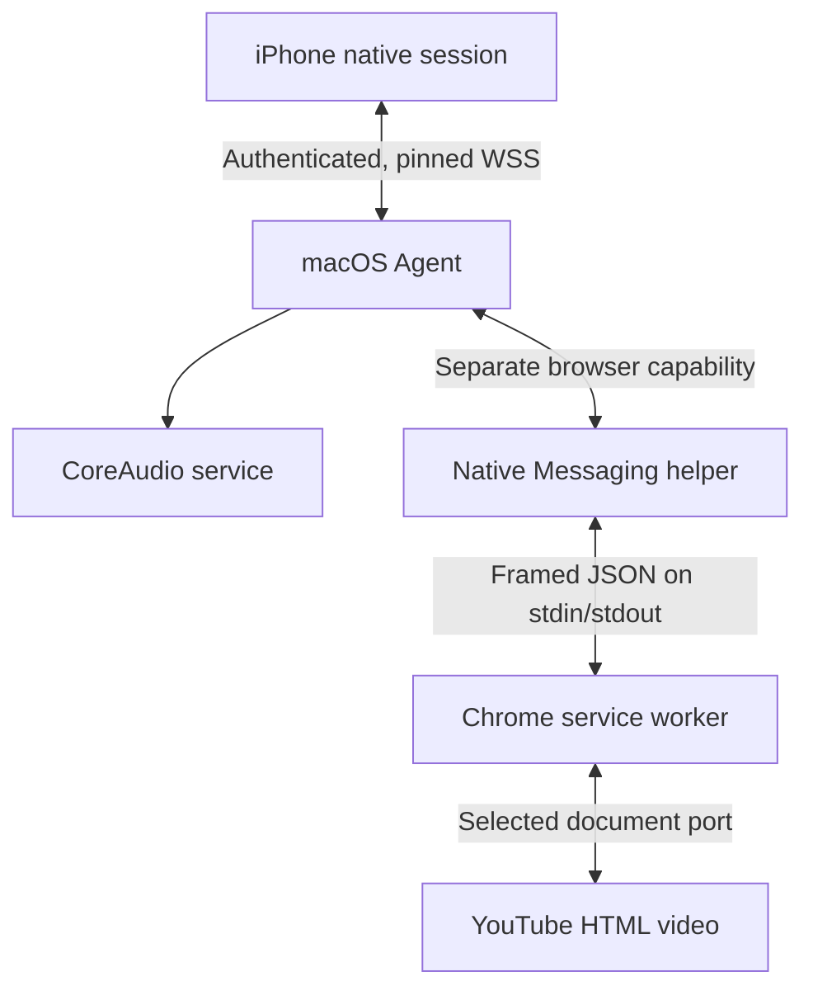
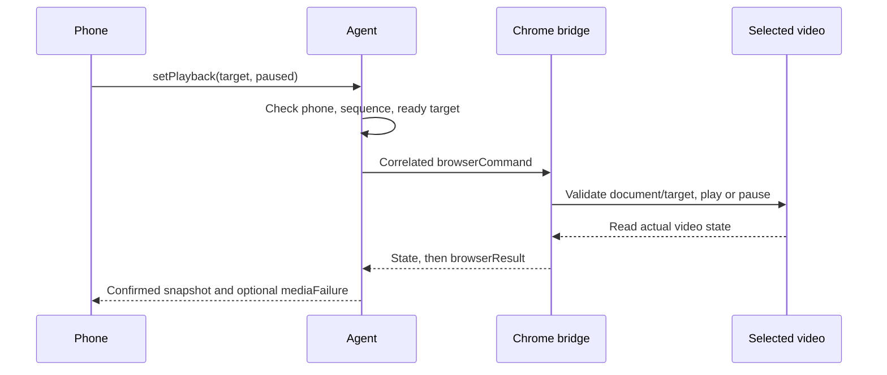

# Selected YouTube Playback

## Status and Scope

Prepared on November 22, 2026, against merged audio baseline `4d11376`. The maintainer passed the prior audio feature's final 23 mobile tests and both CI jobs before merging it. Pairing, real volume/mute, external synchronization, route-based reconnection, and active revocation/re-pairing were checked on the primary devices.

This change adds selected YouTube metadata and absolute play/pause through Chrome Native Messaging. Implementation checks pass 28 mobile tests, 14 extension tests, 31 portable protocol tests, and 17 audio-service tests. Strict TypeScript/ESLint, the extension bundle, and the iOS JavaScript/Hermes export pass. The bridge actor/I/O/client code was additionally type-checked with Linux FoundationNetworking stubs; the actual media service and broker type-check against their portable modules. These results do not establish Apple SDK compilation, Chrome Native Messaging interoperability, or physical-device playback. The maintainer subsequently completed the Mac checks, signed launch, helper installation, Chrome connection, and iOS build after restricting the browser runtime store to macOS/Linux. Chrome connection and the selected title on the phone were confirmed on November 23. After the UUID-casing fix, the maintainer verified actual Pause/Play, browser-to-phone synchronization, changes to another video in the same selected watch tab, and continued audio control after closing it. Final Mac checks after the platform guard and feature CI are pending; broader cases are listed below.

The MVP supports one manually selected, non-incognito `https://www.youtube.com/watch?v=...` tab in desktop Google Chrome. It displays a title, confirmed playing/paused state, position, and optional duration. Seeking, next video, Shorts, embedded players, other browsers, timers, and other video sites are separate increments. Existing preview controls still change sample data only.

## Architecture and Ownership



Chrome starts the helper process through a user-level Native Messaging manifest. The helper connects to the Agent's existing TLS listener using the Agent certificate fingerprint and a separate ephemeral browser capability. Chrome never receives a phone credential. The browser peer may publish media snapshots and answer playback requests; it cannot submit phone audio commands. The Agent remains the authority that accepts commands from paired phones.

| File or directory                                                         | Responsibility                                                                                                |
| ------------------------------------------------------------------------- | ------------------------------------------------------------------------------------------------------------- |
| `apps/browser-extension/src/background.ts`                                | Popup sender validation, selected document ownership, native port lifetime, request correlation and deadlines |
| `apps/browser-extension/src/content.ts`                                   | Idle until selection, selected document port, bounded state publication, one playback operation               |
| `apps/browser-extension/src/youtube-adapter.ts`                           | Standard HTML video reads/play/pause, target identity, title sanitization, ad and autoplay handling           |
| `apps/browser-extension/src/protocol.ts`                                  | Strict directional packet shapes and exact-origin/watch URL validation                                        |
| `apps/browser-extension/src/popup.ts`                                     | Localized setup and selection UI; metadata inserted with `textContent`                                        |
| `apps/browser-extension/browser.config.json`                              | Development extension public key, stable extension ID, and native-host name                                   |
| `apps/browser-extension/scripts/build.mjs`                                | Bundling; checks public-key/extension/native-origin consistency and prevents native-facade browser imports    |
| `apps/macos/BrowserHost/NativeMessageIO.swift`                            | Bounded length-prefixed I/O on separate serial queues                                                         |
| `apps/macos/BrowserHost/BrowserHostRelay.swift`                           | TLS pinning, browser authentication, sequencing, duplex relay and shutdown                                    |
| `apps/macos/BrowserHost/BrowserHostMain.swift`                            | Chrome origin argument check; stdout reserved for protocol frames                                             |
| `apps/macos/scripts/install-browser-host.mjs`                             | User-level helper copy and exact-origin Chrome manifest installation                                          |
| `apps/macos/Sources/RemoteControlAgent/Browser/BrowserBridgeAccess.swift` | Explicit per-run enablement, capability generation, verifier and runtime-file lifetime                        |
| `apps/macos/Sources/RemoteControlAgent/Browser/YouTubeService.swift`      | One browser, one pending playback request, freshness and target checks, confirmed result                      |
| `apps/macos/Sources/RemoteControlAgent/Browser/BrowserControlCard.swift`  | Enable/disable control and browser/selected-media status                                                      |
| `packages/remote-link/Sources/RemotePairing/BrowserBridgeWire.swift`      | Browser-only allowlist, gate, Native Messaging framing, runtime configuration                                 |
| `packages/remote-link/Sources/RemotePairing/BrowserBridgeRuntime.swift`   | Private runtime-file publication, validation, bounded read and generation-aware cleanup                       |
| `packages/remote-link/Sources/RemotePairing/MediaWire.swift`              | Media DTOs, validation, fixed failures, shared monotonic request budget                                       |
| `packages/remote-link/src/media.ts`                                       | Framework-free TypeScript media validation; browser and phone share this subpath                              |
| `apps/mobile/src/features/youtube/`                                       | Confirmed media card and localized failure states                                                             |
| `apps/mobile/src/shared/format-time.ts`                                   | Fractional-safe timestamps, including hour-long videos                                                        |

The existing foreground remote session carries both audio and media slices. Legacy `RemoteAudio*` type/frame names are retained for compatibility. The broker now generates a composite revision for every audio or media update; the underlying HAL revision is tracked separately. A media update therefore cannot be discarded just because the audio revision has not changed.

The native facade exposes `mediaAPIVersion = 1`. An older installed iOS binary shows a rebuild explanation instead of calling an absent playback method. Old audio-only native clients can ignore the optional media snapshot. No new native dependency is needed, but the changed Swift module requires rebuilding the iPhone app.

## Installation for Local Development

All repository commands below run from the repository root. Follow them in order; installation is local to the current macOS account.

1. Install locked workspace dependencies and run the checks:

   ```bash
   pnpm install --frozen-lockfile
   pnpm check
   make -C apps/macos format
   make -C apps/macos check
   ```

   `pnpm check` also builds the unpacked extension at `apps/browser-extension/dist`. Its pinned `esbuild@0.28.2` install script is explicitly allowed in `pnpm-workspace.yaml`; other dependency build scripts are not broadly enabled.

2. Quit the running Agent, then rebuild and open the signed app using the existing ignored local signing configuration:

   ```bash
   make -C apps/macos run
   ```

   If no local configuration exists, use your own team ID as described in the [Mac guide](../apps/macos/README.md). The helper is a separate ad hoc signed command-line target, with no Keychain capability or provisioning requirement.

3. Build and install the user-level Chrome Native Messaging host:

   ```bash
   make -C apps/macos install-browser-host
   ```

   This copies the helper to `~/Library/Application Support/RemoteControl/NativeMessaging/remote-control-browser-host` and writes the manifest at `~/Library/Application Support/Google/Chrome/NativeMessagingHosts/com.antonomelchuk.remotecontrol.browser.json`. It uses no `sudo`. Re-run this command after changing helper code; rebuilding the Agent alone does not replace the installed helper.

4. In Chrome, open `chrome://extensions`, enable **Developer mode**, choose **Load unpacked**, and select `apps/browser-extension/dist`. The expected extension ID is `okbfaijmikpjghbdljpjoealcdhbahfi`. Pin its toolbar button if useful. This is a development installation, not a Chrome Web Store release.

5. Rebuild/install the iOS development app, selecting the physical iPhone:

   ```bash
   pnpm --dir apps/mobile exec expo run:ios --device
   ```

   Expo Go cannot provide this custom native module. Generated iOS sources remain ignored and are not edited manually. Continue with `expo start --dev-client` on later JavaScript-only sessions.

6. In the Agent, choose **Start connections**, then **Enable YouTube**. Existing paired phones keep their saved access. YouTube must be enabled explicitly after every Agent restart.

7. Open a normal YouTube watch page in Chrome. **Reload an already-open page** after initially installing/reloading the extension so its content script is present. Play it once if Chrome requires a user gesture. Open the extension popup on that page and choose **Use this YouTube tab**. Selection also attempts the native connection. After a bridge failure or Agent restart, choose **Connect to Mac** explicitly.

8. On the phone, open **Control your Mac**. The YouTube card should show the selected video's title and confirmed state. Test Pause and Play with a real video; ensure ordinary volume/mute controls still work.

After extension source changes, run `pnpm build:extension`, reload the unpacked extension in Chrome, and reload/select the watch page again. `dist` is generated and ignored; Chrome loads that directory, not the TypeScript source directory.

### Uninstall

First disable YouTube in the Agent and disconnect/remove the extension in Chrome. Remove only the helper and manifest installed for this project:

```bash
rm -f "$HOME/Library/Application Support/Google/Chrome/NativeMessagingHosts/com.antonomelchuk.remotecontrol.browser.json"
rm -f "$HOME/Library/Application Support/RemoteControl/NativeMessaging/remote-control-browser-host"
```

Do not remove Chrome's entire NativeMessagingHosts directory: it may contain other applications. Paired-phone credentials remain separate in Keychain. Normal Disable YouTube removes this run's runtime capability; no credential reset is needed.

## Commands, Freshness, and Failure Semantics

A phone playback command is absolute: `{ type: setPlayback, targetID, paused }`, plus the existing session, request ID and sequence. It is not a blind toggle. The Mac requires a ready snapshot for that exact opaque target. The service worker also checks selection and snapshot freshness, and the content adapter rechecks the video ID and actual video element immediately before dispatch and after asynchronous play completion. Changing the YouTube video or replacing its video element creates a new target UUID.



No requested value is presented as confirmed playback. The card keeps its actual play/pause state until a browser snapshot arrives. Media failures are independent of audio failures; losing the Chrome bridge leaves the authenticated phone audio session usable. Simultaneous writes share the existing one-command limit. Repeated taps during a pending operation are ignored, not saved for later replay.

| Boundary                      | Limit or behavior                                                                                    |
| ----------------------------- | ---------------------------------------------------------------------------------------------------- |
| Text/Native Messaging payload | At most 4,096 UTF-8 bytes                                                                            |
| Media title                   | At most 200 UTF-8 bytes; control/format characters removed                                           |
| Video identity                | Exactly 11 URL-safe YouTube ID characters; no full URL transmitted                                   |
| Position/duration             | Finite `0...604800` seconds; unknown/live duration omitted                                           |
| Native Message framing        | Four-byte little-endian UInt32 length; empty, partial and oversized frames rejected                  |
| Browser ordering              | Native helper assigns increasing sequence; Mac requires next sequence                                |
| Request rate                  | Burst 10; replenishes 10 per second using a monotonic clock                                          |
| Agent peers                   | At most four total outstanding peers, including one browser peer                                     |
| Content snapshots             | Once per second while selected; no page polling while unselected                                     |
| Selected state                | Service worker rejects commands at 3 seconds without page state; Agent clears media at 5 seconds     |
| Playback deadlines            | Content play promise 3.5 seconds; worker 4.5 seconds; Mac service 5 seconds; phone command 8 seconds |
| Liveness                      | Browser heartbeat every 10 seconds; helper receive timeout 25 seconds; Agent idle timeout 35 seconds |
| Pending operations            | One media command; 64 recent browser request IDs retained in memory                                  |
| Recovery                      | Explicit reconnect/reselection; no automatic write replay                                            |

A suspended/background tab can become stale even while the helper's heartbeat remains alive. Fresh state can restore its ready card; commands using the old target are still checked. Closing the selected document clears selection; another open video is not chosen automatically. Pause on an advertisement is rejected by the adapter's best-effort YouTube ad marker. This is not an ad skipper or an assurance that YouTube's DOM will never change.

`HTMLMediaElement.play()` can reject because of browser autoplay policy. The UI asks the user to play once in Chrome. No synthetic interaction or policy bypass is attempted. A timed-out play promise may still settle later; target validation cannot make browser playback transactional. A lost acknowledgement therefore means **check the real player before retrying**, not that playback definitely stayed unchanged. Revocation prevents future phone requests and cancels pending service work, but cannot undo a browser action already dispatched.

## Security and Privacy

- The extension requests `nativeMessaging` and only `https://www.youtube.com/*` host access. It does not request all-site, cookies, history, debugger or blanket tabs permissions. The host permission is broad enough for YouTube SPA navigation; the script stays idle until explicit selection. Incognito is disabled.
- The popup sender must have this extension's ID and exact popup URL, with no originating tab. Content ports require the same extension ID, top-level frame, document ID, expected selected tab, exact YouTube origin, and non-incognito status.
- The native manifest permits one exact extension origin; the helper independently checks Chrome's origin argument. The public manifest key stabilizes the development ID. It is public identity material, **not a code signature or secret**. A local user who installs modified code using that public key is outside this isolation boundary; a Web Store/distribution trust policy is future work.
- Enable YouTube generates a fresh 256-bit random capability. Only its HMAC verifier stays in the Agent. The helper reads the capability from a private runtime file; the extension/page never receives it. This browser role can publish one media target and return results. It cannot authenticate as a saved phone or call audio/power/input actions.
- Runtime directory mode is `0700`; the file is `0600`, owned by the current UID. The store rejects a symlink for the final directory/file, broad permissions, non-regular files, and oversized content; publication uses an exclusive temporary file and atomic rename. It does not claim protection from malicious software running as the same macOS user.
- Runtime configuration contains a private-network address, port, certificate pin, and browser-only capability. It does not contain the TLS private key or saved phone credentials. It lives outside the repository at `~/Library/Application Support/RemoteControl/BrowserBridge/bridge.json`. Do not paste or commit it.
- Disable YouTube revokes the in-memory verifier, closes the browser peer, clears media state, and removes only the matching generation's file. Stop connections also disables the bridge. A crash may leave a file, but a fresh Agent has no matching enabled verifier; old access cannot authenticate to the new process. Explicit re-enable replaces it.
- The helper reuses the native TLS 1.3 certificate-pinning transport and refuses HTTP redirects. Frames are directional allowlists; no browser-provided shell command or script is executed.
- Titles, video IDs and positions exist only as current in-memory state. No viewing history is persisted by this feature. No cookies, page credentials, thumbnails, arbitrary URLs or phone tokens are forwarded. Metadata is displayed as text.
- Native stdout contains framed protocol messages only. Diagnostics use a fixed stderr message without tokens or page metadata. A compromised authorized browser can misreport its own media state; this feature does not authenticate YouTube content.

## Validation Checklist

Automated tests exercise the shared Swift/phone/Chrome fixture, malformed media values and Unicode, directional action separation, duplicate/rate bounds, private-file permissions/symlinks/size/generation cleanup, Native Messaging framing, popup/document sender restrictions, stale target rejection, no automatic replay, HTML play/pause, autoplay rejection, advertisement handling, DOM replacement, SPA navigation, and fractional/hour timestamps. They use deterministic fake Chrome ports and video elements, not a live YouTube session.

The following results were reported by the maintainer on November 23. Pending rows remain unverified for this increment:

| Check                                 | Expected result                                                        | Recorded result                                                    |
| ------------------------------------- | ---------------------------------------------------------------------- | ------------------------------------------------------------------ |
| `pnpm check`                          | Format/lint/types, 28 mobile + 14 extension tests, extension build     | Passed in workspace and on the maintainer’s Mac after the UUID fix |
| Portable Swift packages               | 31 protocol + 17 audio tests                                           | Passed on Swift 6.0.3/Linux                                        |
| iOS export                            | Metro/Hermes bundle resolves media subpath                             | Passed; 1,224 modules                                              |
| `make -C apps/macos check`            | Real Apple client, Agent and helper compile; full crypto suite         | Passed before the iOS platform guard; final repeat pending         |
| Signed Agent and updated iOS app      | Signed Agent and physical iOS build launch                             | Passed; iOS build required the platform guard                      |
| Install/load/select                   | Helper installed, extension selected, Chrome connected, title on phone | Passed, including extension reload/reselection after the UUID fix  |
| Pause/play both ways                  | Phone controls actual video; browser controls update phone             | Passed after UUID canonicalization                                 |
| Change video in selected watch tab    | Change videos in the same selected watch tab                           | Passed: title/time updated and Pause/Play controlled the new video |
| Close selected tab                    | Clear title/playback control while Mac volume remains usable           | Passed                                                             |
| Disable YouTube / quit Chrome         | Media unavailable; phone audio remains usable                          | Pending                                                            |
| Stop/Start or Agent restart           | Browser disabled until explicitly enabled; reconnect reads fresh state | Pending                                                            |
| Autoplay restriction / advertisement  | Clear error/unavailable state; no bypass or blind success              | Pending                                                            |
| Revoke active phone                   | Phone session closes; reconnect denied; no write replay                | Pending                                                            |
| Slow/frozen tab / lost pending reply  | Stale/timeout state; verify actual player before retry                 | Pending                                                            |
| EN/UK, themes, larger text, VoiceOver | Readable titles/time and labelled controls                             | Pending                                                            |

## Troubleshooting

- **Extension disconnected:** start the signed Agent, start connections, enable YouTube, then choose Connect to Mac in the popup. The selected private address must still be reachable; address relocation/discovery is not implemented.
- **Local-network access denied:** check macOS System Settings → Privacy & Security → Local Network for Chrome or the responsible application. A helper started by Chrome does not necessarily have the same permission as a tool run from Terminal. The tool embeds a fallback usage description; actual permission attribution is a native verification item. See [Apple TN3179](https://developer.apple.com/documentation/technotes/tn3179-understanding-local-network-privacy).
- **Native host not found:** re-run `make -C apps/macos install-browser-host`; use desktop Google Chrome, check the exact extension ID, and ensure its manifest points to the installed executable rather than DerivedData. Other Chrome channels/browsers have different registration locations and are not configured here.
- **No selected video:** reload the watch page after extension installation/reload; select it from the popup while that tab is active. Home pages, Shorts and embedded videos are intentionally unsupported.
- **Blocked play:** click Play once in Chrome. Some accounts/content/player states may still reject playback; test the target video manually.
- **Old app / missing controls:** rebuild the iOS development app. A Metro reload cannot add new Swift functions to an installed binary.
- **Errors after native source changes:** reinstall the helper, quit/relaunch the rebuilt Agent, reload the extension and select the tab again. Neither pnpm nor Xcode replaces an already running Chrome helper automatically.

## References

- [Chrome Native Messaging](https://developer.chrome.com/docs/extensions/develop/concepts/native-messaging)
- [Chrome content scripts](https://developer.chrome.com/docs/extensions/develop/concepts/content-scripts)
- [Extension service-worker lifecycle](https://developer.chrome.com/docs/extensions/develop/concepts/service-workers/lifecycle)
- [Expo SDK 58](https://docs.expo.dev/versions/v58.0.0/)
- [pnpm dependency build settings](https://pnpm.io/settings#allowbuilds)
- [ADR 0005](adr/0005-selected-youtube-native-messaging.md)

## UUID Casing Follow-up: November 23, 2026

The maintainer reported that the phone received the current video but Pause did not control it. The browser creates lowercase UUID strings; Swift's UUID JSON encoding produces uppercase text. Strict JavaScript string comparisons treated the same target as different and rejected playback with `targetChanged`. The initial fixture used lowercase IDs on both sides, so the original tests missed the actual serialization difference.

The fix normalizes validated target and request UUIDs to lowercase at TypeScript boundaries and normalizes the adapter's incoming target before comparing it. YouTube video IDs remain case-sensitive and are preserved. A different target is still rejected. Regression tests first reproduced failures in protocol parsing, worker dispatch and the player adapter, then passed after the fix. A phone-summary test covers the same native uppercase input.

`pnpm check` now passes 28 mobile and 14 extension tests and rebuilds the extension. This follow-up changes TypeScript, JavaScript tests and documentation only. Rebuild/reload the Chrome extension, reload/reselect the watch page, and reload the mobile JavaScript. It does not require reinstalling the native helper or recompiling the already updated iPhone app. The previous `BrowserBridgeRuntime.swift` macOS/Linux guard must be retained.

This reproduces and fixes the pause-command identity bug. The earlier stale-tab report and popup-opening problem are not established as the same cause; collect Chrome extension errors if either persists after reloading. The maintainer subsequently confirmed actual Pause/Play, both directions of state synchronization, changing videos in the same watch tab, and audio remaining usable after closing the selected tab.

## Physical-device Follow-up: November 23, 2026

| Scenario                            | Observed result                                                         |
| ----------------------------------- | ----------------------------------------------------------------------- |
| Phone Pause → Play                  | Actual Chrome playback stopped and resumed                              |
| Pause/Play directly in Chrome       | The iPhone icon/state updated automatically                             |
| Another video in the same watch tab | New title and time appeared; phone Pause/Play controlled the new video  |
| Close the selected watch tab        | Title/playback button disappeared; Mac volume control continued working |

These are maintainer-reported checks on the existing MacBook Pro, iPhone XR and desktop Chrome development setup. They do not establish behavior on another device/browser or after prolonged background throttling. Closing the selected tab was checked without a recorded multi-tab retargeting matrix. Reopening/reselecting a closed document, disabling/re-enabling the browser capability, Agent/Chrome restarts, Wi-Fi loss, active phone revocation during playback, long-running/background use, real advertisements/autoplay rejection, and accessibility remain future checks for this increment. The earlier popup-opening and stale-tab reports were not independently root-caused; selecting the extension after reload worked for the verified workflow.

The Mac-only runtime-store API and UUID comparison issues are fixed in source. The complete Mac check passed before the platform guard; repeat it against the final formatted source before committing, then observe both feature CI jobs.
